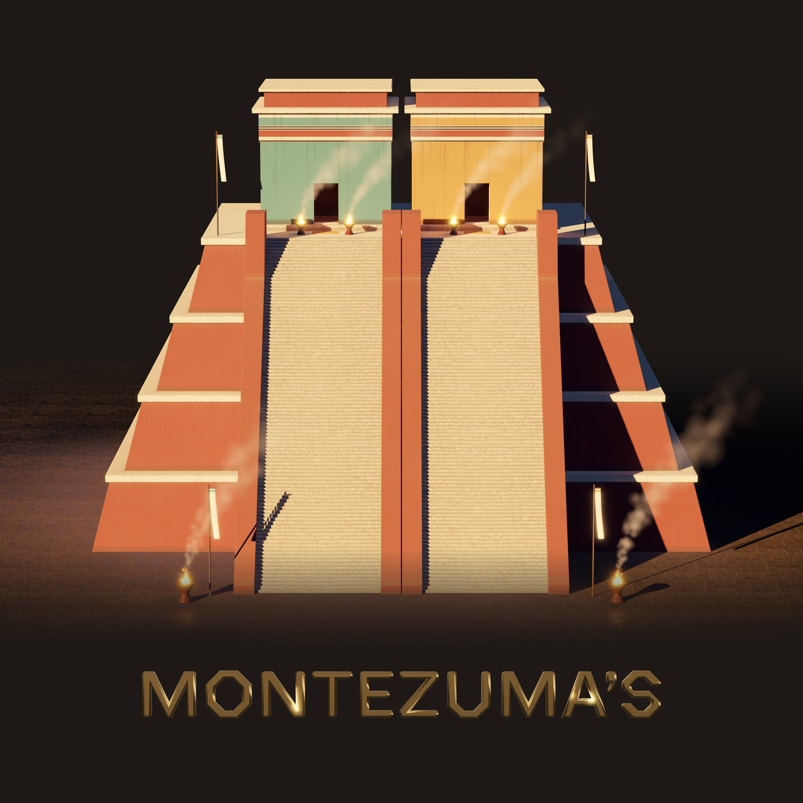
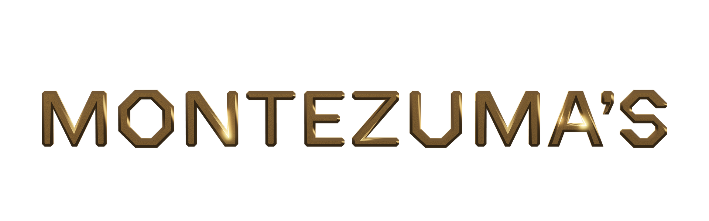
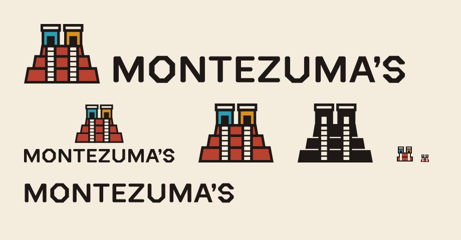
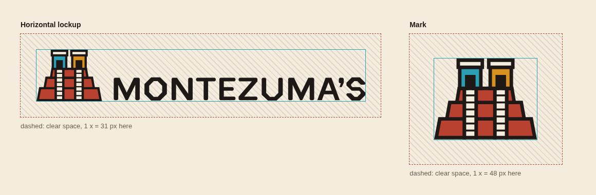
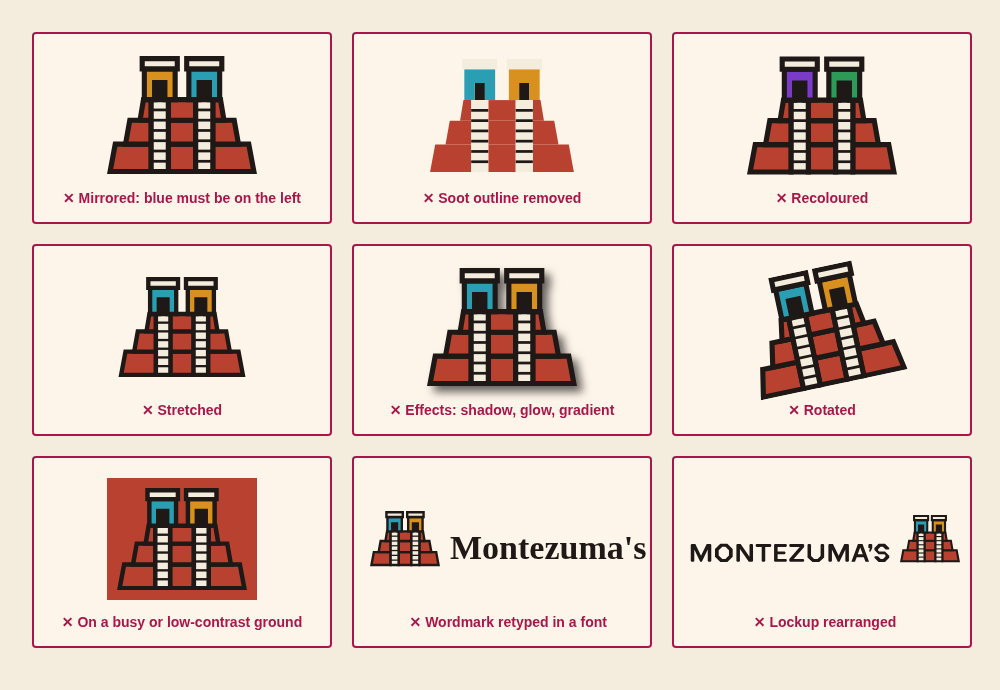
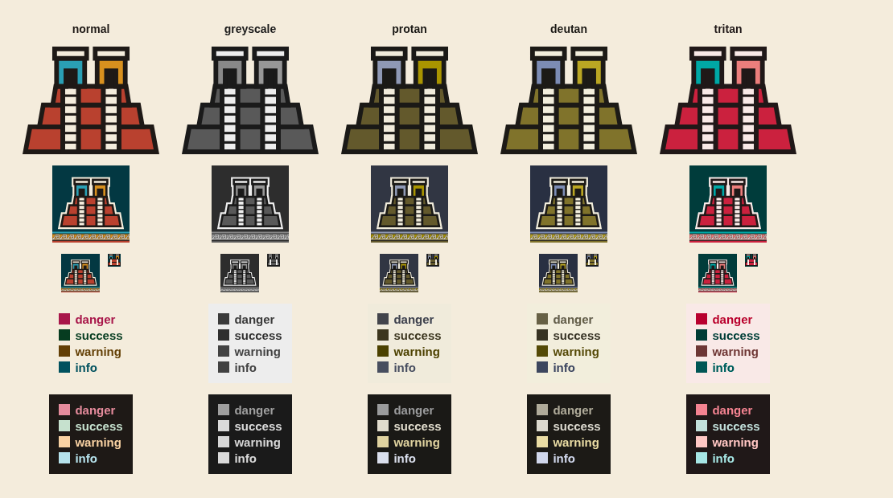
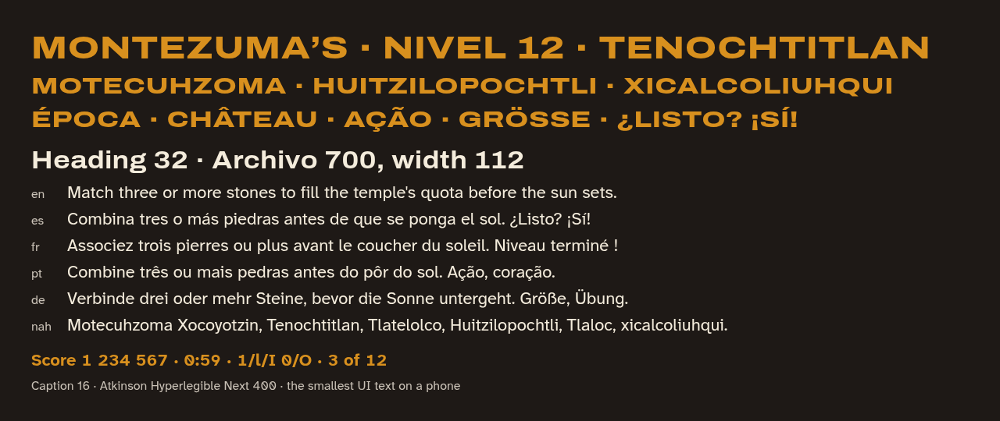
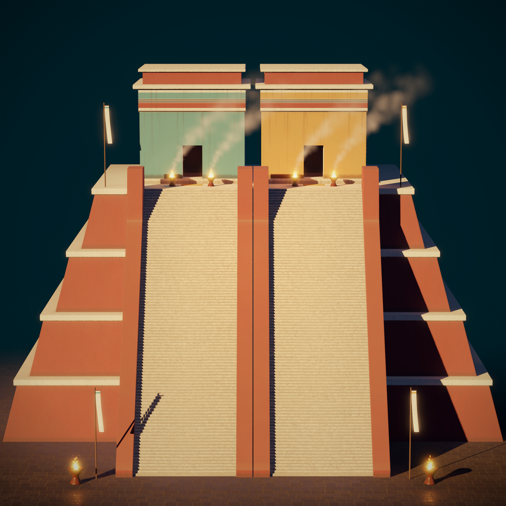
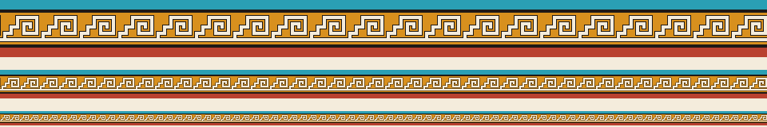

<!-- SPDX-License-Identifier: GPL-2.0-or-later -->
# Montezuma's style guide

*Reference. The rules for applying the Montezuma's identity: the
rendered key art and gold wordmark, the flat logo, colour, type, icons,
UI surfaces, the step-fret band and imagery, with the numbers to check
them. Why it looks this way:
[About the visual identity](../docs/explanation/about-the-visual-identity.md).
Step by step: [Use the identity](../docs/how-to/use-the-identity.md).*

| Version | Date | Change |
|---|---|---|
| 1.0 | 2026-10-19 | First identity (WP-04): twin-temple mark, drawn wordmark, step-fret band, palette, type, tokens |
| 1.1 | 2026-10-19 | The realistic 3D key art leads: rendered mark, gold wordmark, 3D app icon, glass UI panels, photographic site hero; the flat marks serve small, one-colour and HUD sizes; the flat mark's bounds now include its mitred base corners |

## Brand essence

Montezuma's is a bright, crafted match-three set in Tenochtitlan in the
reign of Motecuhzoma II (1502 to 1520). It is **bright, crafted,
grounded in sources, welcoming and confident**; never jungle adventure,
grim, or neo-Aztec pastiche ([brief](identity/brief.md)).

The identity leads the product's look and sets a higher realism bar than
the game, which follows it. Its primary form is the **realistic 3D key
art**: the twin temple as lit, painted and aged stucco architecture, and
the drawn wordmark cast as a bevelled pale-gold solid. The **flat vector
marks** are drawn the painted-book way (a soot outline, flat colour
inside it, no gradients, bevels or glows) and serve wherever a render
cannot: favicons and anything from 16 to 47 px, one-colour jobs,
embossing and the HUD. Palette, type and tokens are shared by both.

## Files

All vector sources and both token files are generated by one script;
never edit them by hand. Run `python3 design/identity/build.py`
(standard library only), then `python3 design/identity/check_contrast.py`,
then `python3 design/identity/render.py` for the PNG previews (needs
`chromium`). The key art is generated and rendered from
`design/keyart/` ([Rebuild the key art](../docs/how-to/use-the-identity.md#rebuild-the-key-art)).

| File | What | Use on |
|---|---|---|
| [`keyart/renders/mark-hero.png`](keyart/renders/mark-hero.png) | The rendered mark: the twin temple lit from the upper left on soot, 2048 x 2048 | The primary mark, 48 px and up: title, splash, press, social |
| [`keyart/renders/lockup-hero.png`](keyart/renders/lockup-hero.png) | The rendered mark over the gold wordmark on soot, 2048 x 2048 | The primary lockup, square spaces |
| [`keyart/renders/mark-on-plaza.png`](keyart/renders/mark-on-plaza.png) | Key art: the temple across its plaza at golden hour, 1920 x 1080 | Title screen backdrop, site hero, store art |
| [`keyart/renders/title-wordmark.png`](keyart/renders/title-wordmark.png) | The gold wordmark, transparent, 1920 x 600 | Over key art or soot |
| [`keyart/renders/app-icon-3d.png`](keyart/renders/app-icon-3d.png) | App icon master, 1024 x 1024, full bleed | 48 px and up; WP-38 makes the store exports |
| [`keyart/*.tscn`](keyart/), [`keyart/gen/`](keyart/gen/) | The Godot scenes and the Python generators the renders are made from | Sources; meshes, textures and lightmaps are build outputs, not committed |
| [`logo/mark.svg`](logo/mark.svg) | The flat mark: the twin temple, full colour | Light grounds |
| [`logo/mark-on-dark.svg`](logo/mark-on-dark.svg) | Full colour with a lime keyline round the silhouette | Dark grounds |
| [`logo/mark-mono.svg`](logo/mark-mono.svg) | One colour, soot; doorways, stairs and roofs knocked out | Light grounds, one-colour jobs |
| [`logo/mark-reversed.svg`](logo/mark-reversed.svg) | One colour, lime; same knockouts | Dark grounds, one-colour jobs |
| [`logo/mark-small.svg`](logo/mark-small.svg) | Pixel-drawn mark on a 16 grid, transparent | Light grounds below 40 px: drawn at 32 px, or 16 px where 32 does not fit |
| [`logo/wordmark.svg`](logo/wordmark.svg), [`-reversed`](logo/wordmark-reversed.svg) | MONTEZUMA'S, drawn as outlines (no font) | Where the mark cannot appear |
| [`logo/lockup-horizontal.svg`](logo/lockup-horizontal.svg), [`-reversed`](logo/lockup-horizontal-reversed.svg) | Mark and wordmark side by side: the primary lockup | Headers, store art, wide spaces |
| [`logo/lockup-stacked.svg`](logo/lockup-stacked.svg), [`-reversed`](logo/lockup-stacked-reversed.svg) | Mark over wordmark | Title screen, square spaces |
| [`patterns/step-fret-band.svg`](patterns/step-fret-band.svg) | Seamless tile, 48 x 72 | Panel frames, site header, store art |
| [`icons/app-icon.svg`](icons/app-icon.svg) | Flat app icon, 1024 x 1024, full bleed | Fallback where a render cannot be used; source of the flat previews |
| [`icons/app-icon-16.svg`](icons/app-icon-16.svg) | App icon, pixel variant | Exactly 16 px or 32 px (favicon, taskbar) |
| [`tokens/montezuma.tokens.json`](tokens/montezuma.tokens.json) | W3C DTCG tokens; drop-in for the game | `game/ui/theme/` |
| [`tokens/tokens.css`](tokens/tokens.css) | CSS custom properties; drop-in for the site | `site/src/assets/` |
| [`previews/`](previews/) | PNG renders: flat icon sizes, lockups, colour-vision checks, construction, misuse, type, band, applications on the key art | Review only; never ship a preview |
| [`directions/`](directions/README.md) | The three explored directions | Record only; not for use |

Print is out of scope, so there are no PDF, EPS or CMYK files.

## Logo

### The rendered mark and key art

The rendered mark is the same twin temple as the flat mark, built in 3D
and lit: hematite-red talud tiers with lime cornices, two lime stairs,
Tlaloc's blue-green shrine on the left and Huitzilopochtli's ochre
shrine on the right, braziers and paper banners. Every still is made in
Godot from the scenes in [`keyart/`](keyart/) with baked light
(`LightmapGI`), rendered at twice its size and filtered down.

| File | Size | Ground | Use |
|---|---|---|---|
| `mark-hero.png` | 2048 x 2048 | Soot `#1e1916`; the studio floor fades into it | The mark on its own, large |
| `lockup-hero.png` | 2048 x 2048 | Soot `#1e1916` | Title, splash, press kit, social avatars |
| `mark-on-plaza.png` | 1920 x 1080 | The scene itself: the plaza, invented precinct buildings, the eastern volcanoes and a golden-hour sky | Backdrop behind UI, site hero, store art |
| `app-icon-3d.png` | 1024 x 1024 | Deep teal fading to dark at the foot | App icon master |
| `title-wordmark.png` | 1920 x 600, transparent | Any dark or photographic ground (see [Gold wordmark](#gold-wordmark)) | Title and headers |

**Rendered or flat.** Use the render wherever the image is 48 px or
more on its shortest side and full colour is possible. Use the flat
marks below 48 px (the flat mark from 40 to 47 px, `mark-small.svg` or
`app-icon-16.svg` below that), for one-colour, embossed, engraved or
knocked-out jobs, inside the HUD, and anywhere a raster cannot go. Never
mix the two in one composition.

Rules for the renders:

- Use them as rendered. Crop `mark-on-plaza.png` freely, but keep both
  shrines and the top of the stairs in frame. Never crop
  `mark-hero.png` or `lockup-hero.png`; their soot field is part of them.
- Never mirror them: blue-green north stays on the left.
- Keep text and UI off the temple itself; over `mark-on-plaza.png`, set
  them on the sky, the plaza or a glass panel.
- Never recolour, re-light, retouch or add effects (glows, lens flares,
  outlines). Scale uniformly only.
- Clear space works as for the flat mark: 0.24 of the temple's width
  round the temple, and the image's own soot margin counts towards it.

### Gold wordmark

`title-wordmark.png` is the drawn wordmark
([`logo/wordmark.svg`](logo/wordmark.svg)) extruded as a solid by
`keyart/gen/wordmark.py`, with a 45-degree chamfer round the front, cast
in burnished pale high-karat gold (silver-rich, pale yellow, never
reddish) and lit for soot.

- **Render it, never recolour it.** No tinting, gradient overlays or
  flat-gold fills that imitate it; if a different look is needed, change
  the material in `keyart/title.tscn` and render again.
- **Grounds:** soot or neutral 800 to 950 as rendered; over photographic
  or key-art grounds, lift it with the filter the previews use
  (`design/identity/render.py`, `GOLD`):
  `filter: brightness(1.45) contrast(1.08) drop-shadow(0 3px 8px rgba(0,0,0,.75))`,
  and darken the ground under it with a gradient to about 85 to 90
  percent of `#0a0806`, as the capsule and site hero do. Never on lime,
  neutral 50 to 600 or any light ground: use the flat `wordmark.svg`
  there.
- **Minimum:** the image 46 px tall (cap height about 12 px, letters
  about 130 px wide); the cap height is about 0.26 of the image height.
  Below that, use the flat wordmark.
- Accessibility: the image is the product's name, so it needs alt text
  ("Montezuma's") or sits beside the name in text.

### The flat mark

A stepped platform of three tiers with sloped (talud) faces, two lime
stairs, and two box shrines under lime roof slabs, each with a doorway
open to its floor. It is drawn on a **96-unit grid**:

| Part | Construction |
|---|---|
| Outline | 3 units soot, centred on every edge, mitred joins |
| Tiers | y 72 to 88, 58 to 72, 46 to 58; bottom widths 84, 66, 49; each face slopes in 2 to 3 units |
| Stairs | 10 wide at x 30 and 56, from the shrine floor (y 46) to the base (y 88); six treads 1.6 thick |
| Shrines | 18 x 18 at x 26 and 52, y 28 to 46; 8 apart |
| Doorways | 6 wide, from y 36 to the shrine floor; soot in colour, knocked out in one colour (widened by one outline so they read the same width) |
| Roofs | 20.5 x 6 lime slabs, 1.25 units wider than the shrine each side |
| Bounds | 87.6 x 69 units including the outline and its mitred base corners (aspect 1.27 : 1) |

**Orientation, always:** the viewer stands in the plaza facing east, up
the west stairs. Tlaloc's shrine (north) is **Maya blue, on the left**;
Huitzilopochtli's (south) is **ochre, on the right**. Never mirror the
mark or swap the colours.

**Greyscale rule:** Maya blue `#2a9fb4` and ochre `#d8901e` are nearly
the same lightness (1.18 : 1), so in greyscale, in one colour and for
most colour-vision deficiencies the two shrines look alike. That is
allowed because **position and the doorway shapes carry the pair**:
left is north, right is south, and each shrine keeps its doorway (soot
or knocked out) in every version, so it always reads as a building. So:

- Never show the shrines without their doorways, and never as two plain
  squares.
- Never use blue against ochre on its own to mean anything (north/south,
  team, state) in UI or art. Pair it with position, a label or a shape.

### Clear space and minimum size

**x** is one shrine's width with its outline: 21 units, which is **0.24 of
the mark's width**. Keep **1 x** clear on every side of the mark and of
every lockup; nothing else (text, edges, other marks) enters it. In the
horizontal lockup the gap between mark and wordmark is 0.75 x; in the
stacked lockup, 0.5 x. Both are built into the files.

| Version | Minimum on screen | Below that |
|---|---|---|
| Rendered mark, rendered lockup, 3D app icon | 48 px on the shortest side | The flat mark or the flat icons |
| Gold wordmark (render) | 46 px tall image (cap height about 12 px) | The flat wordmark |
| Flat mark (full colour, on-dark, one colour, reversed) | 40 px wide | `mark-small.svg` |
| `mark-small.svg`, `app-icon-16.svg` | 16 px; draw only at 16 or 32 px (whole multiples); for any space from 32 to 39 px use 32 | Nothing smaller |
| Horizontal lockup | 28 px tall (about 180 px wide) | The mark alone |
| Stacked lockup | 120 px wide | The horizontal lockup |
| Wordmark alone | cap height 9 px (about 101 px wide) | Do not use |
| App icon master (`app-icon-3d.png`) | 48 px | `app-icon-16.svg` at 16 or 32 px |

The website header logo at 32 px tall (brief) uses the horizontal
lockup; at 360 px wide it takes about 205 px.

### Backgrounds

The renders' grounds are in [the rendered mark and key art](#the-rendered-mark-and-key-art)
and [gold wordmark](#gold-wordmark). For the flat files:

| Version | May sit on |
|---|---|
| `mark.svg`, `lockup-*.svg`, `wordmark.svg`, `mark-mono.svg` | Lime white `#f4ecdc`, neutral 50 to 300, white; flat colour or a quiet photo region whose lightest-to-darkest range stays in that band |
| `*-reversed.svg`, `mark-on-dark.svg` | Soot `#1e1916`, neutral 700 to 950, Maya blue 800 to 950, wine `#6a2224`; dark photo regions only behind a scrim |
| `mark-small.svg` | Light grounds only; on dark use `app-icon-16.svg`, which carries its own field |

Never place the mark on hematite, ochre or Maya-blue 400 to 600 fields,
on the band, on a busy area of a photo or render, or anywhere the soot
outline or lime keyline is under 3 : 1 against the ground.

### Misuse

For the flat files. Never: mirror it (blue must be left); remove the
soot outline; recolour it; stretch or squash it; add shadows, glows, gradients, bevels or
textures; rotate it; set it on a busy or low-contrast ground; retype the
wordmark in a font (the drawn wordmark is the only one); rearrange or
rescale the parts of a lockup. Also never: outline the whole logo with
an extra stroke, crop it, animate parts apart, or put the step-fret band
inside the clear space. The look of depth and metal comes only from the
renders; never fake it on the flat files.

### Wordmark

MONTEZUMA'S is drawn, not typed: cap height 100 units, vertical stems
20, horizontal bars 16, diagonals about 19. Square outer corners are cut
4.5 units at 45 degrees, like a dressed stone block; O, S and U are cut
large on the diagonal and overshoot the cap and base lines by 2 units.
Inner corners stay sharp. The apostrophe is a squared head tapering
into a tail. Tracking is +6 units between letters, with optical
kerning on A' (-16), 'S (-4), NT (-2), MA (-2), TE (-1). It uses no
font, so no font licence sits in the logo.

## Colour

All values sRGB. Display P3, CMYK and spot colours are not specified
(screens only). The tokens file is the source; this table quotes it.

### Brand anchors

One per stone pigment family in the
[Mexica art reference](../docs/reference/history-mexica-art.md#artist-brief),
plus cochineal, a painted-book colour for UI only.

| Name | Hex | RGB | Family | Role |
|---|---|---|---|---|
| Soot | `#1e1916` | 30 25 22 | soot / charcoal black | Outline, text on light, dark surface |
| Lime | `#f4ecdc` | 244 236 220 | lime / calcite white | Light surface, stairs, roofs, text on dark |
| Hematite | `#b9412f` | 185 65 47 | hematite red | The platform; primary on light |
| Wine | `#6a2224` | 106 34 36 | dark hematite red | Pressed states on light, dark fields |
| Ochre | `#d8901e` | 216 144 30 | goethite ochre | South shrine; primary on dark |
| Maya blue | `#2a9fb4` | 42 159 180 | Maya-blue turquoise | North shrine; focus and links (via ramp steps) |
| Cochineal | `#a8174a` | 168 23 74 | codex crimson (UI and cloth, never stone) | Danger on light |

**Ochre is not the yellow piece.** UI ochre `#d8901e` differs from the
yellow piece `#ffcc4d` by CIEDE2000 16.3 and from the orange piece
`#e2661c` by 16.8 (`check_contrast.py` requires 15). Beside HUD quota
icons, never use ochre as the fill behind a yellow or orange piece swatch;
use the band or a neutral surface.

### Ramps

Eleven steps each, generated in OKLCH with the anchor pinned.
Green is a codex green for success only.

| Step | neutral | hematite | ochre | maya | cochineal | green |
|---|---|---|---|---|---|---|
| 50 | `#fef5ea` | `#fff4f2` | `#fff5ea` | `#ebfafd` | `#fff4f5` | `#f0faf3` |
| 100 | `#f4ecdc` | `#fee7e2` | `#ffe9d0` | `#d8f2f8` | `#fee6e9` | `#e1f2e6` |
| 200 | `#e0d8cc` | `#fecbc1` | `#f9d2a3` | `#b6e2ec` | `#ffc9d1` | `#c6e1ce` |
| 300 | `#c9c1b6` | `#f4afa1` | `#edb774` | `#90cedc` | `#f4acb8` | `#a7ceb3` |
| 400 | `#b0a89d` | `#e58f7f` | `#d8901e` | `#64b8c9` | `#e58b9c` | `#86b796` |
| 500 | `#978f85` | `#d4705e` | `#c38111` | `#2a9fb4` | `#d46b81` | `#65a079` |
| 600 | `#7e766c` | `#b9412f` | `#a26a0f` | `#198598` | `#bf4766` | `#41895d` |
| 700 | `#655e54` | `#a13525` | `#81540b` | `#036b7b` | `#a8174a` | `#2e7d4f` |
| 800 | `#4d463d` | `#6a2224` | `#633f05` | `#00515e` | `#860538` | `#155532` |
| 900 | `#373028` | `#5d1208` | `#462b01` | `#033842` | `#5f0626` | `#063c20` |
| 950 | `#1e1916` | `#3e0501` | `#2c1a01` | `#022329` | `#3e0116` | `#012611` |

### Roles

Light is the site's default scheme; dark is the game UI and the site's
dark scheme. Token paths: `color.role.light.<role>` and
`color.role.dark.<role>`.

| Role | Light | Dark | Use |
|---|---|---|---|
| surface | neutral 100 `#f4ecdc` | neutral 950 `#1e1916` | Page and screen panels |
| surface-raised | neutral 50 `#fef5ea` | neutral 900 `#373028` | Buttons, cards, tracks |
| surface-sunken | neutral 200 `#e0d8cc` | neutral 950 `#1e1916` | Wells and inputs; text and text-muted only |
| text | neutral 950 `#1e1916` | neutral 100 `#f4ecdc` | Body text, labels |
| text-muted | neutral 700 `#655e54` | neutral 300 `#c9c1b6` | Captions, help, metadata |
| text-on-accent | neutral 50 `#fef5ea` | neutral 950 `#1e1916` | Text on accent fills |
| accent | hematite 600 `#b9412f` | ochre 400 `#d8901e` | Primary buttons, titles, links, meters |
| accent-pressed | hematite 800 `#6a2224` | ochre 300 `#edb774` | Pressed and selected primary controls |
| outline | neutral 600 `#7e766c` | neutral 500 `#978f85` | Control boundaries, dividers |
| focus | maya 700 `#036b7b` | maya 300 `#90cedc` | Focus ring (3 px) |
| link | maya 700 `#036b7b` | maya 300 `#90cedc` | Links where accent is not used |
| danger | cochineal 700 `#a8174a` | cochineal 400 `#e58b9c` | Errors, destructive actions |
| success | green 900 `#063c20` | green 200 `#c6e1ce` | Success, completion |
| warning | ochre 800 `#633f05` | ochre 200 `#f9d2a3` | Warnings |
| info | maya 800 `#00515e` | maya 200 `#b6e2ec` | Neutral notices |
| disabled | neutral 500 `#978f85` | neutral 600 `#7e766c` | Disabled controls (exempt from contrast) |
| north | maya 500 `#2a9fb4` | maya 500 | Tlaloc's shrine; art fills only |
| south | ochre 400 `#d8901e` | ochre 400 | Huitzilopochtli's shrine; art fills only |
| stage | neutral 900 `#373028` | neutral 950 `#1e1916` | Behind the playable demo |
| stage-text | neutral 100 `#f4ecdc` | neutral 100 | Text, borders and focus inside the stage |
| scrim | black `#000000` at 63 percent | same | Behind modals |

Status colours (danger, success, warning, info) **always come with an
icon or a word**: in greyscale they are not told apart
([colour checks](previews/colour-checks.png)).

Proportions: mostly neutral surface (about 70 percent), soot text and
outlines, one accent per view; hematite and ochre for emphasis; Maya
blue for focus, links and the north shrine. Never: hematite text on
soot (3.2 : 1), ochre or Maya blue as text on lime (under 3 : 1), red
and green as the only difference between two states.

### Approved pairs

Measured by `design/identity/check_contrast.py` (WCAG 2.2; ratios
truncated, not rounded up; scrim pairs are measured on 8-bit composites). The script checks 107 pairs, including the game keys, the
site's CSS in both schemes, Godot's hovered button, and the scrim
over the brightest board; run it with `--markdown` for the full table.

| Pair | Light | Dark | Needs |
|---|---|---|---|
| text on surface | 14.83 | 14.83 | 4.5 |
| text on surface-raised | 16.14 | 11.06 | 4.5 |
| text-muted on surface | 5.45 | 9.77 | 4.5 |
| text-muted on surface-raised | 5.93 | 7.29 | 4.5 |
| accent (as text) on surface | 4.63 | 6.57 | 4.5 |
| accent (as text) on surface-raised | 5.04 | 4.91 | 4.5 |
| text-on-accent on accent | 5.04 | 6.57 | 4.5 |
| text-on-accent on accent-pressed | 10.42 | 9.64 | 4.5 |
| link on surface | 5.27 | 9.99 | 4.5 |
| danger on surface | 6.19 | 7.05 | 4.5 |
| success on surface | 10.67 | 12.49 | 4.5 |
| warning on surface | 7.97 | 12.25 | 4.5 |
| info on surface | 7.64 | 12.50 | 4.5 |
| outline on surface | 3.81 | 5.46 | 3 |
| focus on surface | 5.27 | 9.99 | 3 |
| stage-text on stage | 11.06 | 14.83 | 4.5 |
| Game: text on scrim over a white board | | 5.52 | 4.5 |
| Art: soot outline against hematite, ochre, Maya blue | 3.20, 6.57, 5.57 | | 3 |
| Art: lime keyline on soot, on the app icon field (the icon uses the keylined on-dark mark) | | 14.83, 10.85 | 3 |

### Colour vision

`check_contrast.py` simulates protanopia, deuteranopia and tritanopia
(the physiologically based model of IEEE TVCG 15(6), 2009, severity 1.0) and requires danger
to stay apart from success and from warning in both schemes (CIEDE2000
10 or more, or a lightness contrast of 1.5 : 1). All pass; the closest is
dark danger and success under deuteranopia (CIEDE2000 12.2, 1.63 : 1). The shrine
pair stays apart in hue under every simulation (CIEDE2000 41 or more)
but not in lightness, so the greyscale rule above applies.

## Type

| Job | Family | Settings |
|---|---|---|
| Display: titles, headings, store and site headlines | **Archivo** (variable `wdth` 62 to 125, `wght` 100 to 900) | Titles 800 at width 125, uppercase, +2 percent tracking; headings 700 at width 112 |
| Text and UI: HUD, menus, body, captions, numbers | **Atkinson Hyperlegible Next** (variable `wght` 200 to 800) | 400 body, 700 labels and figures; tabular figures (`tnum`) for score and timer |

### Scale

Game sizes are at the 1280 x 720 reference (tokens `font.size.*`,
`typography.*`); site sizes are rem of a 16 px root (`--text-*`).

| Step | Family, weight | Game size / line | Tracking | Case | Site |
|---|---|---|---|---|---|
| display, title | Archivo 800, width 125 | 56 / 60 | +0.02 em | upper | 3 rem |
| heading | Archivo 700, width 112 | 32 / 38 | +0.01 em | sentence | 1.75 rem |
| subheading | Archivo 700, width 100 | 24 / 30 | 0 | sentence | 1.25 rem |
| body | Atkinson 400 | 22 / 32 | 0 | sentence | 1 rem |
| label | Atkinson 700 | 20 / 26 | +0.01 em | sentence | 0.9375 rem |
| figure | Atkinson 700, tabular | 22 / 26 | 0 | — | — |
| caption | Atkinson 400 | 16 / 22 | +0.01 em | sentence | 0.875 rem |

Never set text below the caption size (16 px on a phone) in the game.
Body text is never in Archivo; Archivo is never below 20 px.

### Fallbacks

- Site: `--font-body` falls back to `system-ui, -apple-system, "Segoe
  UI", Roboto, sans-serif`; `--font-display` to `"Arial Black",
  system-ui, sans-serif`.
- Game: `font.family.*` are empty until the fonts are vendored, so Godot
  uses its default font; once vendored, set them to the `res://` paths.

### Coverage

Checked with fontTools on the pinned files (2026-10-19): both families
cover Spanish, French, Portuguese and German (á é í ó ú ñ ü ç ã õ â ê ô
à è ù ë ï ÿ œ æ ß « » ¿ ¡ „ “ ” ‘ ’ €) and Nahuatl in its usual Latin
spelling (Motecuhzoma, Tenochtitlan, xicalcoliuhqui, Huitzilopochtli,
Tlatelolco). **Gap:** Atkinson Hyperlegible Next has no ō or Ō, so the
macron spelling of vowel length (for example Tenōchtitlan) cannot be set
in UI text; use the usual unmarked spelling. Archivo has all five
macron vowels. Neither covers Greek, Cyrillic or CJK; a later
localisation needs a fallback family.

### Source and licence

Not committed. Vendor them from google/fonts at the pinned commit and
check the sha256 before use; ship each family's `OFL.txt` beside its
font file.

| Family | Files at `google/fonts` commit `47d54ca1ebb14fd864695f1d39dc734f39017c33` | sha256 | Licence |
|---|---|---|---|
| Archivo | `ofl/archivo/Archivo[wdth,wght].ttf` | `0e094a7d3c7c4c25cf1310c4b30014f1dae9332220b1c2c88f4fa996f0b05053` | SIL OFL 1.1, no Reserved Font Name; Copyright 2020 The Archivo Project Authors (<https://github.com/Omnibus-Type/Archivo>) |
| | `ofl/archivo/Archivo-Italic[wdth,wght].ttf` | `305d13b4eb80e62f7d517f78d7c045250d977552a420f2dbed906f314e761305` | |
| | `ofl/archivo/OFL.txt` | `108b4e57c9c796d3d38d0428ca7ee39de47ad93187302718d9b2d8864b9b716b` | |
| Atkinson Hyperlegible Next | `ofl/atkinsonhyperlegiblenext/AtkinsonHyperlegibleNext[wght].ttf` | `5a455d1cfa099b601ab70751bb9673e8fe1854dc4500c80e1a220d0d75e31745` | SIL OFL 1.1, no Reserved Font Name; Copyright 2020-2024 The Atkinson Hyperlegible Next Project Authors (<https://github.com/googlefonts/atkinson-hyperlegible-next>) |
| | `ofl/atkinsonhyperlegiblenext/AtkinsonHyperlegibleNext-Italic[wght].ttf` | `ce9cffed32742ad2d9238c561a93220385e5934cdc02b8eb4097a50efa957dc6` | |
| | `ofl/atkinsonhyperlegiblenext/OFL.txt` | `aca6a428580965d2297d1b718042dd427c2a9443ece3b0d02d758e161e0c4030` | |

Raw URL form:
`https://raw.githubusercontent.com/google/fonts/47d54ca1ebb14fd864695f1d39dc734f39017c33/ofl/archivo/Archivo%5Bwdth,wght%5D.ttf`.

OFL 1.1 covers every use the brief lists: designing with them, static
images and store art, embedding in the game, serving as web fonts, and
video. Conditions: ship `OFL.txt` with any font file, never sell the
fonts on their own, and a modified (for example subset and renamed)
version stays under the OFL. Neither font is in the logo. When vendored,
each file gets a row in `game/assets/PROVENANCE.md` and an entry in
`CREDITS.md`.

## Icons

### App icon

The master is [`keyart/renders/app-icon-3d.png`](keyart/renders/app-icon-3d.png).

| | |
|---|---|
| Subject | The rendered temple filling the square, seen up its twin stairs, no text |
| Field | Deep teal fading to dark at the foot, full bleed; reads as a coloured tile on light home screens and on black ([preview](previews/app-home-screens.png)) |
| Masks | None baked in: no corners, shadows or highlights. Stores and launchers mask it |
| Small sizes | 48 px and up from the master; 16 and 32 px from `app-icon-16.svg` |
| Platform exports | WP-38 (store-art batch) makes every platform size from the master, the Android adaptive layers (temple inside the 66 dp safe zone), the monochrome themed layer (from `mark-mono.svg`) and the iOS dark and tinted variants, checking each platform's current spec on the day |

**Flat fallback:** [`icons/app-icon.svg`](icons/app-icon.svg) is the
flat icon, for anywhere a raster cannot be used. Its field is Maya blue
900 `#033842` (12.7 : 1 against white); the keylined on-dark mark is
about 876 px wide with its keyline, with about 34 px of field between
the keyline and the step-fret band at its foot (2x, 144 px tall), so
nothing sits on the band. Previews of the flat icon:
[1024](previews/icon-1024.png), [180](previews/icon-180.png),
[48](previews/icon-48.png), [32](previews/icon-32.png),
[16](previews/icon-16.png).

### UI icons

No UI icon set exists yet. When one is drawn it follows the mark: 24 px
grid with a 20 px live area, filled shapes inside a 2 px soot outline
(`border.outline-width`), square terminals, corners cut at 45 degrees
(1 px) rather than rounded, front-facing and flat, whole-pixel
coordinates. Selected state: fill in the accent; default: fill in the
surface-raised colour. No letters, no glyph-like marks, no faces. Every
meaningful icon reaches 3 : 1 against its ground and has a text label
or accessible name.

## UI surfaces

Menus and dialogs over key art use **glass panels**: dark translucent
soot with a backdrop blur, a thin pale-gold hairline and a gold primary
button ([preview](previews/app-game-menu.png)). Values are those in
`design/identity/render.py` (`GLASS`, `app_menu`), at the 1280 x 720
reference. They are not yet in the token files; quote them from this
table until they are.

| Part | Value |
|---|---|
| Panel fill | `#14100d` at 62 percent (`rgba(20,16,13,0.62)`) |
| Backdrop | Blur 18 px, saturation 1.2 |
| Hairline | 1 px inside the edge, `#e8c880` at 28 percent |
| Shadow | 0 30 px 80 px, black at 55 percent |
| Corners, padding, gap | Panel radius 14 px; padding 30 px top and bottom, 34 px sides; 12 px between buttons |
| Primary button | Vertical gradient `#e9a63a` to `#c9821b`; soot `#1e1916` label (8.28 : 1 at the top, 5.55 : 1 at the foot); 1 px inner top highlight `#fff0c8` at 60 percent; shadow 0 6 px 18 px, black at 40 percent |
| Secondary button | Lime `#f4ecdc` at 6 percent; lime label; 1 px inner border, lime at 18 percent |
| Buttons | Radius 6 px; padding 13 px by 16 px; Atkinson Hyperlegible Next 700, 21 px, centred, +0.01 em |
| Focus | 3 px ring in dark focus (maya 300 `#90cedc`), 4 px outside the button |
| Caption | text-muted (dark) `#c9c1b6`, at least 16 px |

Rules:

- One primary button per panel. The gradient is for the primary button
  only; nothing else on the panel is gold except the hairline.
- **Backdrop limit:** the blurred backdrop behind a panel must stay no
  lighter than neutral 400 `#b0a89d`. Over that, lime labels on
  secondary buttons stay at 4.5 : 1 or more and captions in text-muted
  too; over the key art's sky they reach about 7 : 1. Over anything
  lighter (a white board, a bright sky), raise the fill or move the panel.
- The hairline is decoration and is not a control boundary; buttons are
  identified by their labels.
- Text on glass never sits over the temple.
- The flat panels of the [colour roles](#roles) (surface, surface-raised,
  2 px soot outline) remain for screens with no key art behind them and
  for the HUD.

## The step-fret band

A stair rising in steps of two cells to a squared hook that turns in on
itself (the xicalcoliuhqui, attested on feather regalia, DR-10), drawn as
plain grid geometry, lime with a soot outline on ochre, between a
Maya-blue stripe and a soot rule above and a soot rule and a hematite
stripe below. Tile: 12 x 18 cells of 4 units (48 x 72).

- Use it as a **frame or divider**: top and bottom of panels, the site
  header, the foot of store art and the app icon. Never as a fill, a
  background behind text, or inside the logo's clear space.
- Height: 36 px default (`band.height`, `--band-height`); 18 px minimum
  (`band.height-min`); below that use plain colour rules (blue, soot,
  ochre, soot, red) instead of the fret.
- Scale the tile uniformly; repeat horizontally only. Never rotate it.
  It may be mirrored top to bottom only to close the foot of a frame.
- Nothing is placed over the band; text sits at least `space.4` (16 px)
  from it.

## Imagery

- **Subject:** the city in daylight: painted stucco, basalt and tezontle,
  a dry highland lake basin with volcanoes, reed marsh and chinampas;
  everyday life (market, ceramics, reed mats, cloth) beside the court.
  Precious materials stay small and personal (greenstone, turquoise,
  gold, shell, feathers).
- **Key art:** realistic and rendered, never painted over.
  - Light: golden hour, a low raking sun from the side, long soft
    shadows, warm light on lime stucco and a cooler sky.
  - Surfaces: painted lime stucco with honest ageing (paint worn at
    edges and kept in recesses, stains under cornices, dust on treads),
    basalt paving; never bare grey stone as the working temple, never
    ruins.
  - Setting: the dry highland basin, with Iztaccihuatl and Popocatepetl
    to the east. No jungle: no moss, vines, roots or rainforest mist.
  - Invented buildings are generic forms and are labelled invented in
    their source files; the temple follows the
    [Mexica art reference](../docs/reference/history-mexica-art.md#artist-brief).
  - Everything in the reference's
    [Avoid list](../docs/reference/history-mexica-art.md#avoid) applies:
    no gold-plated architecture, no Maya forms, no codex colours painted
    one-to-one onto stone.
- **Treatment:** key art and 3D captures as rendered, never retouched
  with effects; the board's own renders for gameplay. Flat 2D art (the
  flat marks, UI icons, the band) keeps the soot outline and flat fills
  from the palette.
- **Composition examples:** (1) store capsule: `mark-on-plaza.png`
  cropped to the temple, darkened to the foot, the gold wordmark across
  it ([preview](previews/app-store-capsule.png)); (2) title screen: the
  key art full screen, the gold wordmark lower left, a glass panel right
  ([preview](previews/app-game-menu.png)); (3) site hero: the key art as
  a photographic hero, gold wordmark in the header, Archivo headline,
  body copy and a gold primary button lower left over a darkening
  gradient ([preview](previews/app-site-desktop.png)).
- **Never:** deity faces or figures, glyphs or anything that looks like
  writing, day signs, skulls, blood or sacrifice, the Sun Stone or any
  disc derived from it, the eagle on a nopal, jungle (vines, moss,
  rainforest), Maya forms, gold armour or war bonnets, neo-Aztec
  revival or Hollywood temple imagery. The reasons and the decisions
  still open are in the
  [Mexica art reference](../docs/reference/history-mexica-art.md#not-used-and-why).

## Layout

- Spacing: `space.1` to `space.6` = 4, 8, 12, 16, 24, 40 px; the site's
  `--space` is 1 rem.
- Corners: `radius.control` 4 px (panels 8 px) on flat surfaces: cut
  stone, not pills. Glass panels over key art use 14 px and their
  buttons 6 px ([UI surfaces](#ui-surfaces)).
- Outline: drawn art and panel frames use a 2 px soot outline
  (`border.outline-width`); focus rings are 3 px (`border.focus-width`).
- Templates in [`previews/applications.png`](previews/applications.png):
  the 3D app icon on home screens, store capsule 460 x 215, website at
  360 px and 1280 px, game title menu with a glass panel, all on the key
  art.

## Tokens and how they map

`tokens/montezuma.tokens.json` is W3C DTCG (format 2025.10): primitives
(`color.brand.*`, `color.<ramp>.<step>`) and semantic roles
(`color.role.light.*`, `color.role.dark.*`) that alias them.

| Game key (placeholder file) | New value | Site variable (`tokens.css`) | Light | Dark |
|---|---|---|---|---|
| `color.surface` | dark surface | `--color-bg` | surface | surface |
| `color.surface-raised` | dark surface-raised | `--color-surface` | surface-raised | surface-raised |
| `color.text` | dark text | `--color-text` | text | text |
| `color.text-muted` | dark text-muted | `--color-muted` | text-muted | text-muted |
| `color.text-on-accent` | dark text-on-accent | `--color-accent-text` | text-on-accent | text-on-accent |
| `color.accent` | dark accent | `--color-accent` | accent | accent |
| `color.accent-pressed` | dark accent-pressed | `--color-accent-pressed` (new) | accent-pressed | accent-pressed |
| `color.focus` | dark focus | `--color-focus` | focus | focus |
| `color.danger` | dark danger | `--color-danger` (new) | danger | danger |
| `color.scrim` | black, alpha 0.63 | — | | |
| — | | `--color-border` | outline | outline |
| — | | `--color-stage`, `--color-stage-text` | stage, stage-text | stage, stage-text |
| `font.size.caption/body/heading/title` | 16, 22, 32, 56 px (unchanged) | `--text-*` (new) | | |
| `font.family.body/display` | empty; `$description` names the family | `--font-body`, `--font-display` | | |
| `space.1`…`space.6` | unchanged | `--space` | | |
| `radius.control` | 4 px (was 8) | `--radius` 0.25 rem (was 0.5) | | |
| `border.focus-width` | 3 px | — | | |
| `motion.duration.fast/normal` | 100, 150 ms (unchanged) | — | | |

New in the CSS: `--color-link`, `--color-success`, `--color-warning`,
`--color-info`, `--color-north`, `--color-south`, `--brand-*`,
`--font-display-stretch/-weight/-tracking`, `--text-*`,
`--band-height`. New in the JSON: `color.brand`, the ramps,
`color.role`, `font.weight`, `font.line-height`, `typography`,
`border.outline-width`, `band`.

## Voice

Plain, warm and exact. Name things by their Nahuatl names in the usual
Latin spelling (Motecuhzoma, Tenochtitlan) with a short gloss the first
time; never "Aztec gold", "lost temple", "ancient secrets" or similar
treasure-hunter phrasing. The copy owner may extend this.

## Legal

- All marks, patterns, icons, key art and previews here are our own,
  generated by `design/identity/build.py`, `render.py` and
  `design/keyart/gen/`, and rendered with Godot, GPL-2.0-or-later
  (`game/assets/PROVENANCE.md`). No third-party image, icon, model,
  texture or font is inside any mark or render.
- The original game is credited by name as the inspiration (*The
  Treasures of Montezuma*, Visual Shape and Alawar); its art is never
  used.
- Open questions (name conflicts, reproducing the Templo Mayor) are
  flagged, not ruled on, in
  [About the visual identity](../docs/explanation/about-the-visual-identity.md#open-risks).
- Store badges and platform names only from their owners' official kits,
  per their guidelines.
