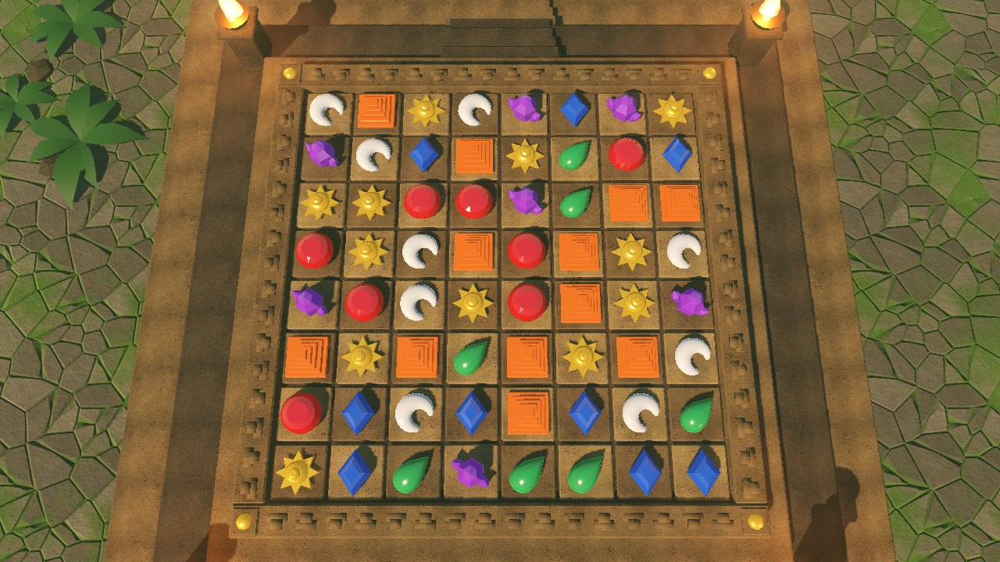
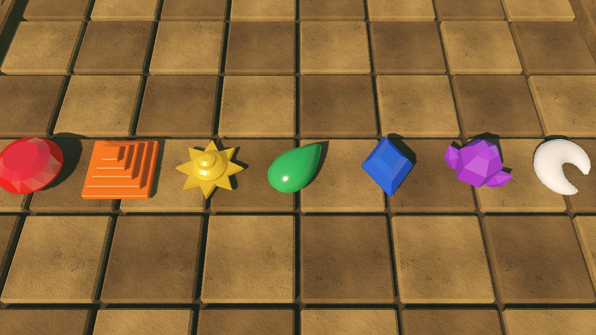

<!-- SPDX-License-Identifier: GPL-2.0-or-later -->
# Art direction: the temple board

*Explanation. Why Montezuma's looks the way it does, and the rules that keep
new art consistent with it. For file formats and commands see
[Board themes](../reference/board-themes.md). This page describes the
first-pass temple; the high-end look it grows into is the
[Visual target](../reference/visual-target.md).*

## The feel we keep

*The Treasures of Montezuma* is remembered for a warm, sunlit Aztec temple:
jewel-bright pieces on carved stone, jungle at the edges, and a board you
read at a glance. We keep that feel and none of its files. Every shape,
colour and texture here is generated by our own scripts from first
principles (stone noise, stepped forms, a step-fret border), which is
easier to prove clean than hand-made art and lets a theme be rebuilt or
varied from one parameter file.

The 3D move is about light, not about camera tricks. The camera stays high
and nearly top-down like the original, so the board keeps its readability;
depth shows in raking sunlight across carved tiles, shadows under pieces,
glints on facets and torchlight at the corners.

## Pieces read by shape first

Seven kinds, each a carved artifact with its own silhouette:

| Kind | Artifact | Silhouette from above | Surface | Value |
|---|---|---|---|---|
| 0 red | Ruby | round brilliant | glassy, faceted | dark |
| 1 orange | Carnelian step pyramid | square with stepped rings | polished stone | mid |
| 2 yellow | Gold sun disc | eight-ray star | metal | light |
| 3 green | Jade drop | teardrop, tip up-right | smooth polish | mid |
| 4 blue | Lapis diamond | upright rhombus | glassy, faceted | dark |
| 5 purple | Amethyst cluster | hexagon with two side points | glassy, faceted | dark |
| 6 white | Moonstone crescent | crescent | pearly, clearcoat | very light |

Colour alone never carries the kind. Ruby, lapis and amethyst share a dark
value (relative luminance 0.10 to 0.12), so they are the three most
different silhouettes: circle, rhombus, cluster. Red and green, the classic
colour-vision confusion, are a circle and a teardrop. Any new theme keeps
this rule: seven silhouettes that tell the kinds apart in greyscale at the
smallest phone size.

Pieces sit a touch smaller than a cell (0.78 of it) so the stone shows
between them and a match line reads as a gap closing. Gems get a faint
emission in their own hue so their colour survives in shadow, and a rim
light so the edge stays crisp against any tile.

## The board is a stage, not a picture

The board is weathered limestone under a warm buff tint, in a soft light
and dark checker. The texture carries the stone's weathering and stays
near-neutral; the tile tints carry the warmth on purpose, because warm
tiles sit well against the green jungle and the cool gems. The checker
helps the eye count cells; its contrast stays below the pieces' so it never
competes. A raised frame with a step-fret relief and four gold studs frames
the play area, and the temple platform, stairs and braziers sit outside it,
where they add place without crossing the cells. Busy detail never goes
under a piece.

## Palette

| Role | Value | Use |
|---|---|---|
| Stone light (warm tint) | `#d2b688` | light tiles |
| Stone dark (warm tint) | `#9a8364` | dark tiles |
| Frame stone | `#a38a66` | frame, platform |
| Shadow stone | `#5c5246` | base, pillars, rocks |
| Gold | `#ffcc4d` | sun disc, studs |
| Jungle | `#24521f` | foliage |
| Torch | `#ff9a3c` | brazier light |
| Glow | `#ffd36b` | selection |

The tile tints keep their `sandstone-light` and `sandstone-dark` token
names in the theme parameters, which other files already read.

Piece colours are in [`design/tokens/temple-board.json`](../../design/tokens/temple-board.json)
so the HUD's quota icons match the board. That file is generated from the
theme parameters, so the 3D pieces and the 2D swatches have one source.

## Material references

The stone and the plaza floor are generated, but what the generator draws
comes from looking at real places. No reference image is copied, traced or
shipped; each one only told us which weathering to model.

- **The original game** ([sources](../reference/rules-sources.md): S2
  StrategyWiki, S3 MobyGames) frames play in a 1935 museum in Cancún, on a
  stone tablet among Aztec totems. So the board is one carved stone
  surface, not a grid of loose tiles, and the theme keeps that tablet.
- **Aztec sculpture** was carved mostly in basalt and andesite and was
  originally painted in strong colours, of which mostly traces survive
  ([World History Encyclopedia, Aztec Art](https://www.worldhistory.org/Aztec_Art/)).
  The board stone therefore carries faint red-ochre pigment only in its
  hollows, where paint would outlast weather.
- **Maya limestone and stucco in the jungle**, as at Palenque ([Texas Tech
  University archive photographs](https://exhibits.lib.ttu.edu/s/openarch/item/36937)), show how such stone ages under rain and
  shade: dark biofilm in the hollows, crustose lichen on exposed faces,
  vertical run-off stains, dissolution pores along the softer beds, and
  moss rooted in every joint. Those are the board stone's layers, and the
  plaza floor's: irregular flags settled at different depths, chipped at the
  edges, soil in the joints, moss spilling from the damp joints while dry
  ones stay bare, leaf litter and damp patches.
- **Mexica turquoise, shell and greenstone mosaics** (Smarthistory) inform
  the gem sets; they are unchanged in this round.

Two scale rules follow from how the textures are used. The board maps about
one stone tile per cell, so the stone avoids any large blotch: it would
repeat on every cell and read as a pattern. Its weathering comes as many
small colonies and fine streaks instead, and its average stays near-neutral
so the light and dark tile materials can tint it. The plaza floor repeats
every few metres around the board, so it is darker (base colour about 0.35
against the stone's 0.65) and lower in contrast, and the board stays in
front.

## Fog references

The first atmosphere pass (WP-51) read as a cream filter over the plaza,
like looking through dirty sunglasses, not as fog. What real mist and
haze look like, and so what the fog has to do:

- **Mist is white, light gives it colour.** Fog and mist are water
  droplets a few micrometres across. They scatter almost all the light
  they meet and absorb next to none (single-scattering albedo close to
  1), the same at every visible wavelength, so mist itself is neutral
  white-grey. It looks gold in sunlight and blue-grey in shade because of
  the light falling on it, never because it is tinted
  ([Copernicus EGUsphere, radiation fog microphysics](https://egusphere.copernicus.org/preprints/2025/egusphere-2024-4074/egusphere-2024-4074.pdf);
  [International Journal of Optics, fog optical properties](https://doaj.org/article/30d6ef1c005c417c8cb7aabd8744f863)).
  The fog's albedo is therefore neutral, and its ambient light is low and
  cool, so mist in shadow is dim rather than glowing.
- **It scatters forward, but thick mist looks diffuse.** A single
  droplet that size sends most light on in roughly the direction it was
  travelling (asymmetry around 0.8), which is why a thin haze glows when
  you look toward the sun. Mist thick enough to hide the ground scatters
  each ray many times, and the light leaving it comes out nearly evenly
  in every direction: a bank looks white from any side, even with the sun
  behind you. That is the temple's case: the sun is behind and above the
  game camera (light reaches the camera after turning through about 144
  degrees), so the fog is lit as diffuse mist, not as forward-scattering
  haze ([About the atmosphere](about-the-atmosphere.md#lit-like-mist-not-like-dust)).
  Shadows of the pillars, steps and ferns falling through it stay dark,
  and those lanes are what make it read as air with light in it.
- **It pools and breaks up.** Dawn mist in the Maya plazas of Tikal and
  Palenque forms in still, damp air on the ground and lies in the low
  places, with a soft top and the ruins rising out of it; as it lifts it
  breaks into drifting banks and wisps with clear ground between them
  ([Dawn over Tikal](https://wheresmybackpack.com/2011/12/18/dawn-over-tikal/);
  [Palenque ruins guide](https://www.mexicotravelandleisure.com/blog/palenque-ruins-guide/)).
  An even layer seen from above is only a tint; the eye reads fog from
  how its thickness changes: crisp floor in the gaps, floor gone under a
  bank.
- **It shows depth.** Mist hides more the more of it a ray crosses, so
  ground further away and lower down fades more. Here the plaza falls
  away from the platform, so the mist thickens toward the edges of the
  frame and the low ground, and the raised platform stands clear of it.
- **Haze shows light, not a wash.** Inside a temple, incense smoke and
  dust are seen only where a shaft of sun passes through dark air; the
  rest of the room stays dark and sharp. The haze's job is to make the
  light visible, not to lighten the picture.

None of these sources is copied; they only set what the fog shader and
its lighting model. The parameters are in
[Board themes: Atmosphere](../reference/board-themes.md#atmosphere) and
the reasoning in [About the atmosphere](about-the-atmosphere.md).

## Light

Late-afternoon sun from the far left at about 42 degrees, warm white, with
shadows; sky ambient kept low so the shadows have shape; four torches warm
the corners. Filmic tonemapping and a light glow make the flames and gold
bloom slightly. The same scene runs on all three renderers the profile
names (Forward+, Mobile, Compatibility for the web demo); Compatibility
looks a little flatter and brighter, which we accept.

## Water

The temple stands in a stone-lined moat. Still water is the cheapest way
to say "real place" in a top-down view: it carries the sky, shows a floor under it, and moves when nothing else does. It
sits round the lowest tier because that is where the game camera looks
past the platform (left and right on a wide screen, top and bottom on a
tall one), and it never comes near the board, so it adds place without
taking the eye.

It stays a backdrop. The water is darker than the tiles, green-teal from
real absorption (red light dies first, so the floor fades as the channel
deepens), and slow: a drift of a few centimetres a second and small
swells. Nothing in it is emissive or fast enough to pull attention while
a cascade plays.

Choices behind the [reference](../reference/water.md):

- **Ripples are computed, not textured.** Gradient noise with its exact
  slope, plus two long swells, gives normals without a texture, so the
  ripples add no sampler (the Metal limit that bit the stone shaders) and
  no generated texture to the build, and they never show a tile repeat.
- **Desktop traces the channel, phones and web blend.** The channel is a
  known stone box, so the desktop shader bends the view ray at the
  surface, follows it to the floor or wall it reaches and draws that
  stone itself, with its slab joints, the walls' shadow and darker
  corners, then absorbs it over the true path. It is opaque and reads no
  screen or depth texture: on the benchmark Mac those copies cost several
  times the water's budget. Mobile and web blend a cheaper surface over
  the real floor and take the path length from the known floor height,
  which is exact for a flat channel.
- **Caustics belong to the floor point.** Both shaders find the floor
  point the eye sees through the water and draw the caustic lines there,
  so they sit on the stone and move with it, not with the surface.
- **Sky reflections only.** Box reflection probes per strip, and then a
  screen-space reflection march in the desktop shader, were both tried to
  reflect the temple into the water. The probes kept re-rendering and
  doubled video memory. The march turned out to cost only about 0.1 ms:
  most of the transparent water's 3.2 to 3.9 ms at 1440p on the benchmark
  Mac came from reading the screen and depth textures, which make a
  tile-based GPU copy the frame and resolve the depth. So the desktop water
  is opaque and traces its refraction through the known channel instead,
  and from the game camera the strips sit at the edge of the frame, so the
  water reflects through the engine's own specular: the sky, plus on
  desktop the scene's reflection probe.

## Why a theme, not a scene

Montezuma's will host mini games with other looks. The board view asks the
asset manifest for logical names (`artifact_0`, `board`, `environment` and
so on) in the current theme and falls back to placeholders for any name a
theme lacks. A new look is a new parameter file and a manifest entry, with
no game code change. That is also why the environment, including sky and
sun, belongs to the theme: mood is part of the look.

## Pipeline choices

- **Generated, not hand-modelled.** Seven pieces, a board and a backdrop
  are rules more than sculpture, and generators make variants and fixes
  cheap. They also make provenance simple: the script is the source.
- **OBJ plus Godot text scenes, not glTF.** Each mesh is one OBJ with one
  material, and the scene (`PF_*.tscn`) and material (`MI_*.tres`) that use
  it are readable text. Materials stay real Godot materials with rim,
  clearcoat and custom shaders, reviewable in a diff, and nothing depends
  on per-file import settings (the repo ignores `.import` files). The mesh
  generator writes the OBJ itself so output is byte-identical between runs.
- **Triplanar stone, no UVs.** Stone textures tile and map triplanar, so
  generated meshes need no unwrapping and texel density is the same on
  every surface.
- **Physically based materials, tiered by file.** The
  [Visual target](../reference/visual-target.md) asks for stone, gold and
  gems that hold up close on desktop and still run on a mid-range phone
  and in a browser. So every surface has one physically based texture set
  (base colour, normal, occlusion-roughness-metallic, height for stone)
  and each material comes as a base file every tier can load plus, where
  desktop can afford more, a `hi/` file of the same name. A missing variant
  falls back to the base, and mobile and web builds leave `hi/` out
  entirely, so a theme can be upgraded one surface at a time.
- **Real optics where the eye checks them.** Gem reflectance comes from
  each stone's index of refraction (ruby 1.76, quartz 1.54), so rubies
  flash brighter than amethysts the way real ones do. On desktop the clear
  gems refract the board behind them with a little dispersion and tint it
  by absorption, which is what makes a gem read as glass rather than
  plastic; translucent stones (jade, moonstone, carnelian) scatter light
  under the surface instead. Phones and the web keep opaque gems with
  rim light and reflections, because refraction needs a copy of the screen
  every frame and sub-surface scattering is desktop-only in Godot.
- **Readability over physics.** The piece colours stay the ones in the
  palette (they are also the HUD tokens), textures only modulate them, and
  the faint emission that keeps each kind's value in shadow stays on every
  tier. Where realism and the greyscale test disagree, the test wins.
