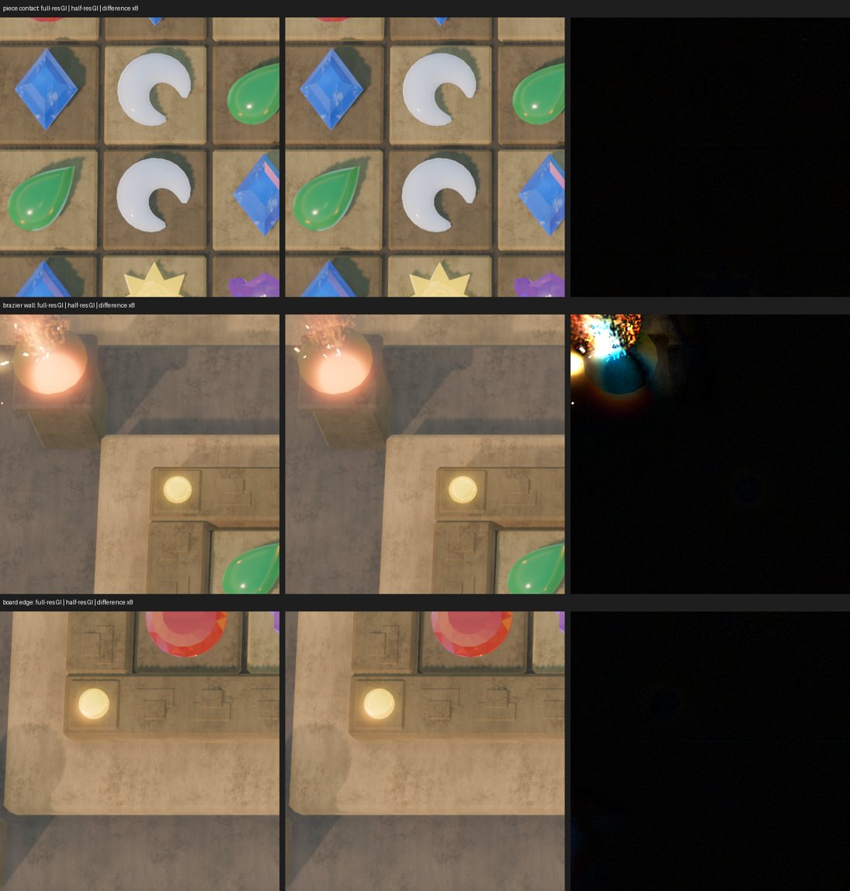

<!-- SPDX-License-Identifier: GPL-2.0-or-later -->
<!-- Copyright (C) 2026 Charles (opsroller) and Montezuma contributors -->
# Benchmark results

*Reference. Frame times and readability results measured with the
[benchmark and readability capture](benchmark.md), per machine, tier,
driver and resolution, against the
[tier budgets](visual-target.md#quality-tiers). How to run it and add a
row: [Run the benchmark](../how-to/run-the-benchmark.md). Why the tiers and
budgets are set as they are:
[About quality tiers](../explanation/about-quality-tiers.md).*

All times are milliseconds, nearest-rank percentiles over a 60 s capture
after a 10 s warm-up, unless a row says otherwise. "Over budget" counts
frames over the tier's `budget_ms`.

## Machines

| Machine | CPU and GPU | Memory | Display | OS | Godot | Build |
|---|---|---|---|---|---|---|
| Mac mini (Mac16,10) | Apple M4, 10-core GPU (Metal 4, Apple9) | 16 GB | Studio Display, 5K, 60 Hz | macOS 27 | 4.7.2-stable editor binary | `main` at 1b780d1 (WP-29 effects, WP-46 benchmark); universal extension, `CMAKE_BUILD_TYPE=Release`; textures from `gen_theme_textures.py` |

## Frame time

Mac mini M4, Metal, Forward+, 2026-10-18.

| Tier | Resolution | 3D scaling | `frame_ms` p50 | p95 | p99 | max | Over budget | Budget p95 | Verdict |
|---|---|---|---|---|---|---|---|---|---|
| `desktop-high` | 2560×1440 | native, TAA | 22.97 | 25.06 | 25.58 | 3561 (one hitch) | 2326 of 2326 | 16.6 | over budget, about 40 fps |
| `desktop-high` (second run) | 2560×1440 | native, TAA | 23.09 | 25.14 | 25.66 | 29.4 | 2574 of 2574 | 16.6 | over budget |
| `desktop-standard` | 1920×1080 | MetalFX temporal, 0.77 | 16.66 | 16.87 | 17.39 | 26.0 | 2761 of 3599 | 16.6 | holds 60 Hz; over only by the display period (below) |

| Tier | `cpu_ms` p50 | p95 | p99 | `gpu_timing` | Draw calls p95 (max) | Primitives p95 (max) | Video memory max | `replay.diverged` |
|---|---|---|---|---|---|---|---|---|
| `desktop-high` | 25.55 | 26.20 | 2215 | false | 129 (165) | 143 396 (217 548) | 454 MB | false |
| `desktop-high` (second run) | 25.61 | 26.46 | 29.66 | false | 129 (170) | 144 630 (217 548) | 452 MB | false |
| `desktop-standard` | 17.63 | 17.86 | 26.35 | false | 137 (192) | 131 586 (202 686) | 364 MB | false |

Measurement notes:

- **No GPU time on Metal.** Every `viewport_get_measured_render_time_gpu`
  sample is 0 with Godot 4.7.2's Metal driver, so `gpu_timing` is false
  and `gpu_ms` means nothing.
- **`cpu_ms` includes waiting for the GPU.** On Metal its p50 is above
  `frame_ms` p50, so it counts the wait for the next drawable, not only
  CPU work.
- **`desktop-high` with `--disable-vsync`.** A 30 s run gives p50 22.34,
  p95 25.27, p99 25.63, the same as with vsync.
- **`cpu_ms` p99 of 2215 in the first `desktop-high` run** is in that
  run's report as written; `frame_ms` for the same run has p99 25.58, so
  those `cpu_ms` samples do not match the frames' wall-clock time.
- **`desktop-standard` is capped by the display.** At 60 Hz each frame
  is 16.67 ms, just above the 16.6 ms budget, so frames that keep up still
  count as over budget. Godot's Metal driver stays display-synced with
  `--disable-vsync` (30 s runs: p50 16.66 to 16.67, p95 16.98 to 16.99),
  so how much headroom there is under 16.6 ms is unknown.
- **The window can change size mid-run.** In three of six
  `desktop-standard` runs the report's `device.resolution` was 3140×2104,
  5120×2576 or 5120×2880 instead of 1920×1080. Those runs are not in the
  table; only runs whose `device.resolution` matches `--size` count.
- **These runs used report schema 1.** Schema 2
  ([Benchmark](benchmark.md#budget)) judges `frame_ms` against whole
  60 Hz periods with a tolerance (so `desktop-standard` above passes and
  `desktop-high` fails), locks the render size and fails a run whose
  render or window size changes, writes `gpu_ms` as null on Metal, and
  times `process_ms` per frame instead of `Performance.TIME_PROCESS`, a
  once-a-second maximum that explains the 2215 ms `cpu_ms` p99 above.

## Draw calls

Draw calls are a count: a software renderer gives the same numbers a GPU
does with the same renderer, scene and size, so these runs count against
the cap though their frame times do not. Cloud container, llvmpipe (Mesa,
LLVM 20.1.2) under Xvfb, `opengl3` driver, Compatibility renderer,
`--quality=web`, 1280×720, 60 s capture after 10 s warm-up, extension
built `Release`, 2026-10-18. The replay matched its plan in every run.

| Build | Draw calls p95 | max | Primitives p95 | Web cap |
|---|---|---|---|---|
| `main` at b7a7157, before the fire | 313 | 355 | 106 602 | 200 |
| `main` at b23a88a, with the WP-49 fire | 324 | 366 | 99 614 | 200 |
| Same, with web batching and one sun cascade | 74 | 116 | 51 852 | 200 |

Where the draws went, from 30 s runs at b7a7157 changing one thing each:
the sun's shadow (four cascades on Compatibility, each drawing every
caster again) was about 195 of 304; one orthogonal cascade alone brought
304 to 211; batching the pieces and markers ([Board view](board-view.md#draw-calls))
took it the rest of the way, to 60. The four omni torch lights cost no
draws (Compatibility shades unshadowed lights in the base pass). Godot
4.7.2's Compatibility renderer reports its shadow-map draws under the
scene pass, so `draw_calls_by_pass.shadow_p95` is 0 there.

## WP-29 effects

The busiest-board replay plays every totem and power-up effect, so the
numbers above include them. On this machine they fit `desktop-standard`
(it keeps 60 Hz) and do not fit `desktop-high` (p95 25.1 ms against
16.6 ms). The M4's 10-core GPU is in the "Apple M1 Pro class" that
[Visual target](visual-target.md#quality-tiers) names for `desktop-high`,
so this is a miss on that tier's own hardware. The cost of the effects alone was not isolated: the benchmark
has no switch to turn them off.

## WP-51 atmosphere

Cost of the volumetric haze, dust and light-shaft cards alone: `main` at
83feede (WP-47 lighting) against the same plus the WP-51 commits
(dc2ed98). Mac mini M4, Metal, Forward+, `desktop-high`, 2560×1440,
vsync off, busiest-board replay seed 52, 10 s warm-up and 60 s capture
with `tools/bench/run_bench.sh`, 2026-10-19. Textures and fire
generated and lightmaps baked on both builds; the two builds ran
alternately in one session, two runs each.

| `frame_ms` | `main` run 1 | `main` run 2 | WP-51 run 1 | WP-51 run 2 | Change (mean of runs) |
|---|---|---|---|---|---|
| mean | 47.71 | 48.09 | 48.10 | 47.95 | +0.13 |
| p50 | 46.71 | 47.23 | 47.13 | 46.91 | +0.05 |
| p95 | 54.75 | 55.49 | 55.78 | 55.41 | +0.48 |
| p99 | 56.74 | 57.09 | 57.82 | 57.33 | +0.66 |
| Frames in 60 s | 1258 | 1248 | 1248 | 1252 | −0.2% |

| Measure | `main` | WP-51 |
|---|---|---|
| Video memory max | 1482 MB | 1504 MB |
| Draw calls p95 (scene pass) | 274 (97) | 275 (98) |
| CPU p95 (ms) | 0.8 | 0.8 |
| Scene report | `volumetric_fog` false, 0 fog volumes, 12 GPU particle systems (160 particles) | `volumetric_fog` true, 1 fog volume, 13 GPU particle systems (480 particles) |
| Saturation, `all_on` readability capture at 2560×1440 (0 to 255) | 58.8 | 72.2 |
| Mean luma, same capture | 133.3 | 131.1 |

The two `main` runs differ by 0.5 ms at p50, so the p50 change is within
run-to-run noise. With the haze, 14 of 17 `desktop-high` feature rows are
met; volumetric fog is now one of them.

## Pieces out of GI

Pieces were dynamic GI objects (`gi_mode = 2`) after WP-47, so Godot
voxelized all 64 into `VoxelGI` on every frame; they now stay out of GI
(`gi_mode = 0`) and only receive it. Machine: RTX 4080 SUPER, Ryzen 9
7950X3D, NixOS, GNOME on Wayland, Godot 4.7.2 from nixpkgs, Vulkan,
Forward+, `desktop-high` at 2560×1440 (FSR 2 at 0.5), 60 s capture after
10 s warm-up, on the live desktop. GPU timing is available on this
driver.

GNOME keeps FIFO presentation when Godot asks for vsync off, so the
uncapped runs set `display/window/vsync/vsync_mode=3` (mailbox) in an
`override.cfg`.

| Build | Presentation | `frame_ms` p50 | p95 | p99 | `gpu_ms` p50 | Video memory max |
|---|---|---|---|---|---|---|
| `main` at b67b96a | vsync, 60 Hz | 16.74 | 17.86 | 20.71 | 3.08 | 1467 MB |
| Pieces out of GI | vsync, 60 Hz | 16.70 | 16.83 | 20.08 | 4.75 | 711 MB |
| `main` at b67b96a | mailbox, uncapped | lost the Vulkan device in warm-up, 2 runs of 2 | | | | |
| Pieces out of GI | mailbox, uncapped | 2.15 | 5.35 | 6.32 | 1.98 | 711 MB |

With vsync on, the GPU clocks down between frames, so `gpu_ms` there is
not a measure of the work. Uncapped, `main` stopped with
`VK_ERROR_DEVICE_LOST` in warm-up both times, while the pieces out of GI
ran at `frame_ms` p50 2.15 ms.

On the Mac mini M4 (Metal, `desktop-high`, 2560×1440, vsync off, seed
52, three alternating runs per build, which agreed within 0.6 ms; both
builds without baked lightmaps):

| Build | `frame_ms` p50 | p95 | Video memory max | Verdict |
|---|---|---|---|---|
| `main` at b67b96a | 50.0 | 59.4 | 1503 MB | over budget |
| Pieces out of GI (a83326a) | 17.5 | 18.4 | 747 MB | over budget: p95 0.7 to 1.3 ms above the 17.5 ms limit |

`desktop-high` p95 on the M4 is 18.4 ms against the 17.5 ms limit: still
a miss. The M4 presents paced to the display even with vsync off, so no
frame there is shorter than 16.67 ms and p50 sits near that floor; the
miss is in the tail. The follow-up is the M4's p95 tail (hitches and
frames that miss a present), not the mean cost. The budget is unchanged.

## GPU time per pass and per effect

Where the GPU time of one frame goes, and what each effect costs alone,
the way players see the game. Machine: RTX 4080 SUPER, Ryzen 9 7950X3D,
NixOS, GNOME on Wayland (the live desktop, not headless), Vulkan,
Forward+, Godot 4.7.2 from nixpkgs, extension built `Release`.
`desktop-high` exclusive full screen at the screen's native size
(`--bench-fullscreen --quality-native`: 3D at 1.0, no upscaler, TAA):
a 4K monitor the desktop had in portrait, so 2160×3840, the same
8.3 million pixels as 3840×2160,
vsync off with mailbox presentation (`override.cfg`, since GNOME keeps
FIFO otherwise), busiest-board replay seed 52, 3 s warm-up and 6 s
capture, every run alone on the GPU, 2026-10-19, at this change.
Per-pass times are one `--gpu-profile` frame; they move by a few
hundredths of a millisecond between frames.

| Pass | GPU ms |
|---|---|
| Render opaque pass | 4.74 |
| Render GI + directional and omni shadows | 0.88 |
| TAA | 0.70 |
| Process SSIL | 0.56 |
| Render 3D transparent pass | 0.55 |
| Copy final framebuffer (SSIL/SSR) | 0.47 |
| Glow | 0.43 |
| Render sky | 0.39 |
| Render depth pre-pass | 0.39 |
| Sub-surface scattering | 0.22 |
| Copy screen texture | 0.20 |
| Process SSAO, tonemap | 0.19 each |
| Auto exposure, merge specular, copy depth texture | 0.12 to 0.13 each |
| Fog volumes, fog, cluster, VoxelGI relight, GPU particles, shadow setup | 0.06 or less each |
| Frame (`gpu_ms` p50) | 11.36 |

`frame_ms` p50 11.99, p95 12.45 ms; CPU p50 0.32 ms, so the frame is
GPU-bound. Each effect turned off alone with `--quality-off`, against
two baseline runs (`gpu_ms` p50 11.36 and 11.39):

| Feature off | `gpu_ms` p50 | Saved |
|---|---|---|
| `ssil` | 9.74 | 1.6 |
| `voxel_gi` | 9.77 | 1.6 |
| `area_light` | 10.12 | 1.2 |
| `glow` | 10.34 | 1.0 |
| `auto_exposure` | 11.00 | 0.4 |
| `ssao` | 11.18 | 0.2 |
| `ssr`, `volumetric_fog`, `subsurface_scattering`, `gem_refraction`, `heat_haze`, `decals`, `parallax_occlusion`, `fog_fire_light` | 11.30 to 11.43 | none measurable |

`ssr` saves nothing because the temple's environment leaves SSR off.
With VoxelGI or SSIL off the frame differs by a mean of 3.65 and 2.79
of 255 against 0.32 between two runs of one build. Soft shadows in the
opaque pass cost 1.3 ms for the sun and 1.0 ms for the four fire lights
at `high` (measured by switching each filter to hard). Why none of these
is turned off: [About quality tiers](../explanation/about-quality-tiers.md#cutting-cost-without-changing-the-look).

**Triplanar sampling.** The stone shader sampled all three triplanar
projections (9 to 12 anisotropic fetches) on every pixel, in the depth
pre-pass and again in the opaque pass. It now drops projections under
2% weight and skips their fetches. Measured back to back:

| Build | `frame_ms` p50 | p95 | `gpu_ms` p50 | Depth pre-pass | Opaque pass |
|---|---|---|---|---|---|
| `main` at 791a680 shaders | 13.00 | 13.32 | 12.77 | 0.93 | 4.97 |
| This change | 11.97 | 12.65 | 11.37 | 0.39 | 4.61 |

A capture of the same frame (1920×1080, frame 80) differs from
`main`'s by 0.29 of 255 on average, the same as two runs of one build.

**GI at half resolution.** `rendering/global_illumination/gi/use_half_resolution`
is on in `project.godot`: VoxelGI is traced at half resolution and
upscaled. Back to back on the same setup: `gpu_ms` p50 11.40 before,
10.81 after. Frame 25 of the replay captured at native 2160×3840
(`--write-movie`, 30 fps fixed), twice with full-resolution GI and once
with half:

| Region | Full vs full: mean, p99.9, max | Full vs half: mean, p99.9, max |
|---|---|---|
| Whole frame | 0.15, 41, 172 | 0.47, 45, 172 |
| Piece contact (720, 1700, 480×480) | 0.02, 1, 8 | 0.68, 1, 4 |
| Board edge (80, 2560, 480×480) | 0.07, 5, 7 | 0.71, 3, 5 |
| Brazier wall (0, 860, 480×480) | 1.30, 90, 164 | 2.45, 98, 163 |

Differences are per-pixel maximum over the channels, in 0 to 255. Half
resolution lifts the whole frame by under 1 level evenly and leaves no
edge: no pixel at piece contact or the board edge moves more than 5.
The large values at the brazier are its flames and sparks, which differ
between any two runs. The crops, with the difference amplified 8 times:

The gem shader also stopped asking
for the screen texture's mip chain it never read (copy screen texture
0.20 to 0.17 ms).

Other findings:

- **Nothing redrawn needlessly every frame except VoxelGI.** The
  brazier's `FlickerLight3D` changes its light energy every frame, and
  Godot re-lights the `VoxelGI` grid whenever a dynamic light inside
  it changes: 0.05 to 0.06 ms. With the flicker stopped, the pass is
  gone and nothing else changes.
- **No shader compiles stall a frame.** Godot compiled 139 surface and
  71 specialization pipelines before the capture and 11 surface and 5
  specialization pipelines during it (effects the replay shows for the
  first time), and none at draw time, so an ubershader drew while each
  compiled (`render.pipeline_compilations`, [Benchmark](benchmark.md#report)).
- **The M4 at native 5K.** An exported release build of `main` (ba0e7c6)
  full screen at 5120×2880, 3D at 1.0 with no upscaler, vsync off, takes
  `frame_ms` p50 112.8 ms with 0.75 ms of CPU work a frame (from the M4
  benchmark queue, 2026-10-19), so it is GPU-bound. That is about 5.6
  times this machine's 11.4 ms scaled to 5K's 1.78 times the pixels.
  Godot 4.7.2's Metal driver returns no GPU timestamps
  (`timestamp_query_pool_get_results` clears the buffer), so
  `--gpu-profile` prints a total of 0 there and the M4 cannot be split
  per pass from Godot.

## Mac mini M4 at native 5K

This change against its merge base with `main` (c0f387e). Mac mini M4,
Metal, Forward+, `desktop-high`, full screen at native 5120×2880 with
3D at 1.0 and no upscaler, vsync off, busiest-board replay seed 52,
5 s warm-up and one 10 s capture per build, run back to back with no
other Godot process, 2026-10-19. Textures and fire generated and
lightmaps baked in both builds. The merge base has no
`--quality-native`, so it ran with a local, uncommitted patch that
sets the same bilinear 1.0 scaling; that leaves TAA off there, while
`--quality-native` here keeps TAA on.

| Build | `frame_ms` p50 | p95 | p99 | Frames in 10 s | `cpu_ms` p95 | Draw calls p95 | Video memory max |
|---|---|---|---|---|---|---|---|
| Merge base c0f387e (TAA off) | 113.9 | 114.7 | 115.0 | 88 | 2.04 | 277 | 2107 MB |
| This change 42413a0 (TAA on) | 112.1 | 115.5 | 138.0 | 89 | 1.65 | 241 | 2275 MB |

Every frame rendered at 5120×2880 and the replay matched its plan in
both runs. The p50 drops 1.8 ms even with TAA added; p99 138.0 is one
slow frame in a run of 89. Both are far over the 16.6 ms budget: at
native 5K the M4 is GPU-bound at about 9 fps.

## Ground mist rework

Cost of reworking the WP-51 fog into ground mist (`SH_AtmosphereFog`,
`MI_AtmosphereFog` and `PF_Environment.tscn`) against `main`,
`desktop-high`, bench scene, 2026-10-19.

**Mac mini M4** (Metal, native 5K with no upscaler, vsync off, seed 52,
10 s per run, both orders):

| Build | `frame_ms` p50 | p95 | Video memory max |
|---|---|---|---|
| `main` at b67b96a | 140.3 | 146.2 | 2813 MB |
| Ground mist (8bf141d) | 139.9 | 146.2 | 2813 MB |

**RTX 4080 SUPER** (Vulkan, Forward+, NixOS, GNOME on Wayland, live
desktop, exclusive full screen at native 3840×2160 with no upscaler,
uncapped with the mailbox `override.cfg`, 6 s warm-up and 20 s capture,
one run each with no other GPU work running). `desktop-high` normally hands
anything above 720 lines to FSR 2; for these runs both builds used the
same local, uncommitted build with `kHighInternalHeight` raised to 2160,
so the 3D view rendered at native resolution. The `main` build is `main`
at 791a680 with this change's three files swapped back.

| Build | `frame_ms` p50 | p95 | `gpu_ms` p50 | p95 | Video memory max |
|---|---|---|---|---|---|
| `main` | 9.96 | 10.13 | 9.78 | 9.91 | 1459 MB |
| Ground mist | 10.01 | 10.22 | 9.85 | 10.00 | 1459 MB |

The mist adds about 0.07 ms of GPU time at native 4K (under 1%). It
samples its 3D noise twice per froxel instead of once, over a fog volume
half as tall.

## Fog veil over the board

Cost of replacing the ground mist's clear square over the board with a
thin veil (`SH_AtmosphereFog`, `MI_AtmosphereFog`, `PF_Environment.tscn`)
against `main` at dbaa1fc, `desktop-high`, bench scene, 2026-10-19.

**RTX 4080 SUPER** (Vulkan, Forward+, NixOS, live GNOME desktop, render
size locked at 3840×2160, vsync off, 6 s warm-up and 20 s capture, two
rounds alternating `main` and the veil, lightmaps rebaked for each; the
3D view rendered through `desktop-high`'s FSR 2, as on `main`):

| Build | `frame_ms` p50 | p95 | `gpu_ms` p50 | p95 | Video memory max |
|---|---|---|---|---|---|
| `main`, round 1 | 5.03 | 7.05 | 4.16 | 6.11 | 1151 MB |
| Veil, round 1 | 4.98 | 7.04 | 4.15 | 6.10 | 1151 MB |
| `main`, round 2 | 5.00 | 7.06 | 4.15 | 6.11 | 1151 MB |
| Veil, round 2 | 5.00 | 7.05 | 4.15 | 6.10 | 1151 MB |

The veil's third noise sample per froxel costs nothing measurable: the
fog grid's size, not the shader, sets the fog's cost. The runs used an earlier
tuning of the veil (1.5 per metre, 0.3 m, 14 m tiles); its parameters do
not change the work per froxel.

Readability on the same machine, `readability.tscn`, shipped veil values:

| Capture | Rule 2 (worst cell contrast loss, clear cells; pass ≤ 40%, ≥ 25%) | Rule 4 (worst change; pass ≤ 10%) |
|---|---|---|
| `main`, `desktop-high`, 3840×2160 | PASS: 3%, 100% | FAIL: 15.2% |
| Veil, `desktop-high`, 540×1170 | PASS: 23%, 56% | PASS: 7.7% |
| Veil, `desktop-high`, 3840×2160 | PASS: 26%, 53% | FAIL: 11.8% |
| Veil, `desktop-standard`, 540×1170 | PASS: 18%, 34% | PASS: 7.9% |
| Veil, `desktop-standard`, 3840×2160 | PASS: 23%, 38% | FAIL: 10.3% |

Earlier veil settings that set the rule 2 thresholds, same check,
`desktop-high`, 540×1170: 1.5 per metre, 0.3 m, 14 m tiles lost 61% in
its worst cell (14% clear); a 4 m noise tile at 0.6 per metre left 12% of
cells clear at 3840×2160.

Rule 4's worst group at 4K is the same on both builds: kind 2 on the
light tile, whose contrast rises with glow (+5.7% alone) and with auto
exposure's response to the plaza mist (+6.5% alone on `main`). The veil
lowers it there, which is why the veil's 4K figures are below `main`'s
([About the atmosphere](../explanation/about-the-atmosphere.md#how-rule-2-is-measured)).

## Feature rows

`check_features.py` on the same reports. Rows that fail are the
lighting, reflection and atmosphere work in WP-47 to WP-53, still to do.

| Tier | Rows met | Met | Not met |
|---|---|---|---|
| `desktop-high` | 6 of 18 | Forward+, sun shadows 4096, depth and height fog, glow, TAA, GPU particles under the limit | AgX, auto exposure, LightmapGI, VoxelGI or SDFGI, SSIL, SSAO, shadowed fire lights, SSR, reflection probes, volumetric fog, colour-grade LUT, depth of field |
| `desktop-standard` | 8 of 19 | Forward+, no VoxelGI, no SDFGI, sun shadows (4096, need 2048), depth and height fog, glow, MetalFX temporal, GPU particles under the limit | AgX, auto exposure, LightmapGI, SSIL, SSAO, shadowed fire lights, SSR, reflection probes, volumetric fog, colour-grade LUT, depth of field |

## Readability

Captured at 540×1170 with each tier's settings; the thresholds then in
[Readability checks](benchmark.md#readability-checks). Rule 2 was then a
luma-difference check, since replaced by per-cell contrast loss (current
figures: [Fog veil over the board](#fog-veil-over-the-board)). Both tiers
fail the same four rules.

| Rule | `desktop-high` | `desktop-standard` | Pass |
|---|---|---|---|
| 2 Persistent effects leave the board alone (old luma-difference check) | FAIL: mean 12.56, p99 30 | FAIL: mean 12.66, p99 29 | mean ≤ 1.0, p99 ≤ 4 (old) |
| 4 Piece-to-tile contrast holds | FAIL: worst change 21.6% | FAIL: worst change 21.2% | ≤ 10% |
| 5 Kinds tell apart (closest pair, shade 0 / shade 1) | FAIL: greyscale 10.34 / 6.18, protanopia 14.86 / 11.40, deuteranopia 14.84 / 11.78, tritanopia 17.59 / 16.27 | FAIL: greyscale 9.96 / 5.90, protanopia 14.40 / 11.19, deuteranopia 15.04 / 11.16, tritanopia 17.53 / 15.81 | ≥ 12 and ≥ 1.5 × the in-kind spread |
| 6 Bloom stays within a quarter cell | FAIL: 5946 px, 4.18% of the board | FAIL: 4220 px, 2.97% of the board | ≤ 0.1% |
