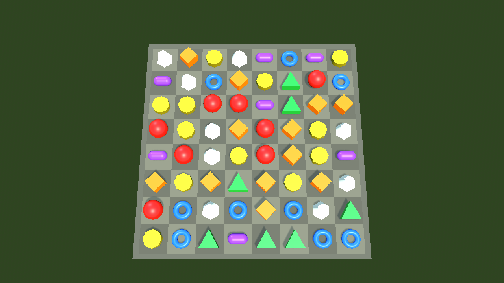
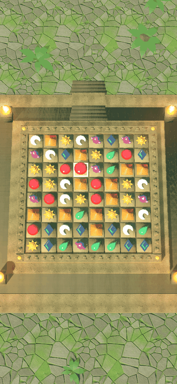
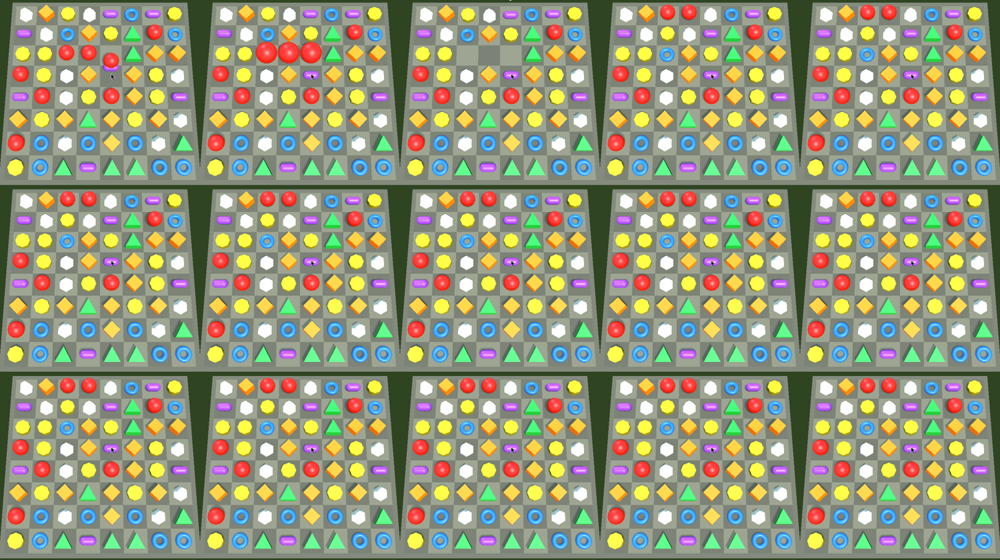
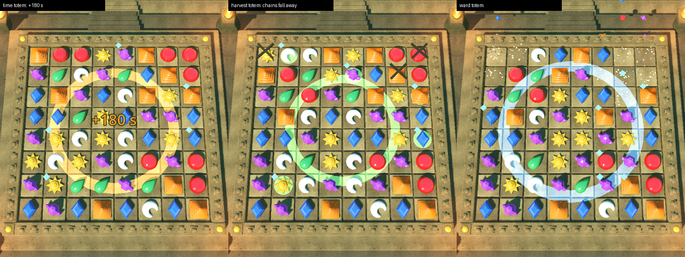

<!-- SPDX-License-Identifier: GPL-2.0-or-later -->
# Board view

Reference for the 3D board: its classes, scenes, layout, camera and feel
constants. For people changing or using the board view. Why it is built
this way: [About the board view](../explanation/about-the-board-view.md).

Code: `extension/src/board/`. Scenes: `game/scenes/board/`. Owner:
graphics-programmer (WP-12 to 14, 29).

## Classes

All in namespace `montezuma::godot_binding`, registered by
`register_board()` (`extension/src/board/register_board.cpp`).

### `BoardView3D` (Node3D)

Draws a `Match3Board` and plays back results. It never applies a rule.

| Member | Kind | Meaning |
|---|---|---|
| `show_board(board: Match3Board)` | method | Draws the board as it is now, no animation. Call again after the board is re-dealt |
| `play(result: Dictionary)` | method | Plays a `Match3Board.try_swap` result step by step (see [Move animation](#move-animation)), with any [effects](#effects) it carries, then emits `animation_finished` |
| `show_marks(marks: PackedInt32Array)` | method | Markers on every cell, row-major (see [Markers](#markers)); drawn now, or when the playing animation ends |
| `get_marks() -> PackedInt32Array` | method | The markers the pieces show now |
| `show_hints(pairs: Array, seconds: float = 0)` | method | A pulsing ring under both cells of each `[a, b]` swap, until the next move, or for `seconds` when above 0 |
| `clear_hints()`, `has_hints()` | method | Removes the hint rings; whether any show |
| `play_effect(label: String, cells: Array)` | method | Plays one effect outside a move: `label` is `totem:<id>` or `powerup:<id>`; a label without a colon, such as `swap`, plays nothing. For the benchmark's `bench_event` (WP-46) and look-dev |
| `get_effects_played() -> Dictionary` | method | Effect beats scheduled since the board was built, by name (`totem_<id>`, `power_up_<id>`, `gem_collect`, `steel_break`, `chain_break`, `mark_placed`), and `overrun_seconds`: the most any move's effects ran past its plan (0 when rule 3 holds); for tests |
| `play_illegal(a: Vector2i, b: Vector2i)` | method | Bounces the two pieces toward each other and back, then emits `animation_finished` |
| `is_busy()` | method | True while an animation plays; taps are ignored then |
| `skip_animation()` | method | Jumps to the end of the playing animation and emits `animation_finished` |
| `animation_speed` | property | Playback speed, 0.1 to 10, default 1. Fast-forward and reduced motion use it; outcomes never change. `Match3Game` sets it from the UI's `reduced_motion` setting, at start and on every change: `feel::kReducedMotionAnimationSpeed` (2) when on, 1 when off |
| `cell_at_screen(pos: Vector2) -> Vector2i` | method | Cell under a screen position using the active camera; `(-1, -1)` off the board |
| `get_board_width()`, `get_board_height()` | method | Size of the board last shown |
| `cell_size` | property | World size of one cell, 0.25 to 4, default 1. Theme art is built for 1 |
| `theme` | property | Theme in the asset manifest; empty (default) means its `default_theme`. Changing it rebuilds the view |
| `get_board_padding()` | method | How far the drawn board (frame or slab edge) reaches past the outer cells, in cells. The camera fits to it |
| `swap_requested(a: Vector2i, b: Vector2i)` | signal | The player asked to swap two adjacent cells |
| `animation_finished` | signal | A `play` or `play_illegal` finished; the view now matches the board |
| `cascade_step(step: int)` | signal | Step `step` (0 = the swap's own match) starts clearing. Audio plays `cascade_<step+1>` and effects hook here |
| `layout_changed` | signal | The board was (re)built; cameras refit |

### `BoardCamera3D` (Camera3D)

Fixed camera that frames the whole board at any window size.

| Property | Default | Meaning |
|---|---|---|
| `board_view_path` | empty | The `BoardView3D` to frame |
| `tilt_degrees` | 15 | Pitch away from straight down, toward the player |
| `margin` | 0.08 | Fraction of the viewport kept empty on each side |

It refits on viewport `size_changed` and the view's `layout_changed`, and
otherwise never moves. Field of view is vertical, 40°.

### `BoardPlaytest` (Node3D)

Free play on one 8×8, 7-kind board with no level: answers
`swap_requested` with `try_swap`, then calls `play` or `play_illegal`.
Deals a new board after a `stuck` result. Properties: `board_view_path`,
`seed`. Read-only: `get_board()`, `get_score()`. The game scene
([Match3Game](match3-game.md)) does this job for real levels.

### `PieceLibrary` (C++ only)

Resolves visuals from one theme of the asset manifest and pools piece
nodes per kind. `game/assets/manifest.json` holds `default_theme` and
`themes.<theme>`, a map of name to `res://` path (contract:
[Asset manifest](contracts.md#asset-manifest-owner-technical-artist-wp-09-11)).
The view reads `themes[theme]`, or `themes[default_theme]` when `theme` is
empty. Names, scale and files: [Board themes](board-themes.md).

| Theme name | Used for | Fallback |
|---|---|---|
| `artifact_0` … `artifact_6` | Piece of that kind: a `PackedScene` or a `Mesh` | Placeholder primitive (below) |
| `board` | Board under the pieces: a `PackedScene`, tile tops at y = 0 | Stone slab with alternating cell tiles |
| `environment` | Sky, every light and the backdrop, added once and kept across redeals | Plain sky, warm key light with shadows, cool fill light |
| `cell_highlight` | Marker shown at the selected cell, keeping the scene's own height | None; the lifted, enlarged piece alone shows the selection |
| `fx_match` | One-shot `CPUParticles3D` started at each cleared cell when its clear begins; frees itself on `finished` | None |
| `bonus_<power-up id>` | Badge on a piece carrying that power-up | Placeholder badge (below) |
| `marker_gem`, `marker_steel`, `marker_chain` | Gem, steel and chain on a piece | Placeholder markers (below) |
| `fx_totem_<totem id>`, `fx_power_up_<power-up id>`, `fx_gem_collect`, `fx_steel_break`, `fx_chain_break`, `fx_power_up_placed`, `fx_hint` | That effect: a `Node3D` scene placed at the cell (a totem: the board centre), freed when its beat ends, or when its particles finish | Placeholder effect (see [Effects](#effects)) |

A missing manifest, theme, name or a path that does not load gives a
warning and the fallback. The themed board is built for the theme's board
size (temple: 8 × 8); a level of another size needs a theme built for it.

Placeholders differ by outline as well as colour, seen from above:

| Kind | Colour | Outline |
|---|---|---|
| 0 | red | circle (sphere) |
| 1 | orange | diamond (turned cube) |
| 2 | yellow | octagon (gold coin) |
| 3 | green | triangle |
| 4 | blue | ring (torus) |
| 5 | purple | pill (capsule lying flat) |
| 6 | white | hexagon |

## Scenes

| Scene | Root | Contents |
|---|---|---|
| `game/scenes/board/board.tscn` | `Board` (Node3D) | `View` (BoardView3D), `Camera` (BoardCamera3D). No lights: the view adds the theme's `environment` |
| `game/scenes/board/board_playtest.tscn` | `BoardPlaytest` | `board.tscn` instance, wired to `Board/View` |
| `game/scenes/game/game.tscn` | `Game` (Match3Game) | `board.tscn` instance; see [Match3Game](match3-game.md) |
| `game/scenes/main.tscn` | `Main` | `game.tscn` instance |

Children the view adds, back to front: `Environment` (sky, lights,
backdrop), `Slab` (the board), `CellHighlight`, `Pieces` (each piece
carries its markers as a `Marks` child), `Effects` (match bursts, totem
and power-up effects), `Hints`. Lights come from the theme's environment; the fallback is
one warm key light about 65° up with soft shadows (opacity 0.6) and one
cool fill light at 0.35 energy, no shadow.

## Layout

The board lies on the view's XZ plane, centred on the view's origin. Cell
`x` runs along +X, cell `y` along +Z, so row 0 is the far edge and shows
at the top of the screen. Cell centre:
`((x - (w-1)/2) * cell, 0, (y - (h-1)/2) * cell)`. Pure functions in
`board_layout.hpp`, tested in `extension/src/board/tests/`.

## Camera fit

The camera looks at the view's origin from `tilt_degrees` off vertical and
backs off to the smallest distance where every corner of the drawn board
(cells plus `get_board_padding()`, measured from the board's meshes), at
board level and at piece height (0.6 cells), is inside the viewport minus
`margin`. Portrait phones fit by width, wide screens by height; the board
is never cropped.

Each refit also places the far depth of field when the active camera
attributes (the camera's own, else the environment's) are a
`CameraAttributesPractical` with the theme's `dof_far_beyond_board`
metadata: `dof_blur_far_distance` becomes the view depth of the board's
far edge at board level (`layout::far_depth`) plus that many metres, so
the blur stays on the backdrop at every window size
([Board themes: Post-processing](board-themes.md#post-processing)).

## Feel constants

`extension/src/board/feel.hpp`, tuned in the feel pass (WP-40).

| Constant | Value | Meaning |
|---|---|---|
| `kSwapSeconds` | 0.12 s | A swap's travel time |
| `kIllegalLegSeconds` | 0.09 s | Each leg of an illegal bounce |
| `kIllegalReach` | 0.45 cell | How far an illegal swap travels before bouncing |
| `kSettleSeconds` | 0.18 s | A changed piece dropping into place |
| `kSettleDropCells` | 1.5 cells | Height it drops from |
| `kClearPopSeconds` | 0.05 s | Cleared piece pops |
| `kClearShrinkSeconds` | 0.10 s | Then shrinks away |
| `kClearPopScale` | 1.25 | Size at the pop |
| `kFallGravityCells` | 120 cells/s² | Gravity for falls and spawns |
| `kFallMinSeconds` | 0.08 s | Shortest fall |
| `kSpawnStartScale` | 0.3 | New piece's size as it enters |
| `kSpawnGrowFraction` | 0.4 | Share of its fall spent growing to full size |
| `kCascadeGapSeconds` | 0.04 s | Pause between cascade steps |
| `kShuffleSeconds` | 0.35 s | Shuffle glide |
| `kRedealOutSeconds` | 0.18 s | Old deal shrinking away |
| `kRedealInSeconds` | 0.22 s | New deal growing in |
| `kTotemLeadSeconds` | 0.32 s | A firing totem's lead-in before its clear (fireballs fall, paint morphs) |
| `kFireballDropCells` | 5 cells | Height fireballs fall from |
| `kPowerUpBurstSeconds` | 0.28 s | A power-up's blast, beams or flash |
| `kLabelSeconds`, `kLabelRiseCells` | 0.5 s, 0.9 cell | Floating text (`+60 s`, `×2`, `+1500`) |
| `kGemFlySeconds`, `kGemFlyCells` | 0.3 s, 1.5 cells | A collected gem flying away |
| `kBreakSeconds` | 0.25 s | Steel shattering, a chain falling away |
| `kMarkPopSeconds`, `kMarkGoneSeconds` | 0.18 s, 0.12 s | A marker growing in, shrinking away |
| `kHintPulseSeconds` | 0.6 s | One pulse of a hint ring |
| `kSelectedScale` | 1.18 | Size of the selected piece |
| `kSelectedLiftCells` | 0.12 cell | Lift of the selected piece |
| `kSwipeCellFraction` | 0.3 | Swipe threshold as a share of one cell on screen |
| `kSwipeMinMillimetres` | 2.5 mm | Smallest swipe threshold |
| `kCameraTiltDegrees` | 15° | Camera pitch from straight down |
| `kCameraFovDegrees` | 40° | Vertical field of view |
| `kCameraMargin` | 0.08 | Empty viewport fraction per side |

## Move animation

`play` reads the cell events of the result (contract "MoveResult events";
fields in [MoveResult reference](move-result.md)) and builds a plan of
phases (`extension/src/board/animator.hpp`), played on one tween:

| Phase | Starts | Lasts | Shows |
|---|---|---|---|
| Swap | 0 | `kSwapSeconds` | The two pieces trade cells |
| Clear (per step) | when the previous phase lands, plus `kCascadeGapSeconds` after step 0 | `kClearPopSeconds + kClearShrinkSeconds` | Cleared pieces pop to `kClearPopScale`, then shrink away |
| Fall (per step) | when its clear ends | the longest fall in the step | Pieces fall under gravity (`kFallGravityCells`, at least `kFallMinSeconds`); new pieces start `drop` rows above the board, grow from `kSpawnStartScale` and fall in |
| Effect (per step with a `lead`) | before the step's clear | its `lead` | A totem's lead-in; `repaints` morph here: the old piece shrinks, the new kind grows in |
| Shuffle | after the last step | `kShuffleSeconds` | Pieces glide to their shuffled cells (`shuffle_map`) |
| Redeal | after the last step | `kRedealOutSeconds + kRedealInSeconds` | Old pieces shrink away, the new deal grows in |

A fall of `n` rows takes `sqrt(2n / g)` seconds: one row about 0.13 s, the
full 8-row board about 0.37 s.

`show_board`, or a `cell_size` change, during an animation stops every
tween first, the new deal's grow included, and frees pieces on their way
out. A test drives the real rules for hundreds of moves, shuffles and
`clear_cells` effects included, and checks the walk always ends on the
board.

When the animation ends or is skipped, the view releases cleared pieces
to the pool and checks every cell against the board; in debug builds a
mismatch logs a warning, and the view resyncs either way. A result
without `cascades` (older binding) falls back to the swap followed by one
settle beat.

## Effects

Totem and power-up visuals (WP-29). Code:
`extension/src/board/effects/` (`effect_plan.hpp` is Godot-free and
tested in `effects_tests`; `board_effects.*` builds the nodes). Like the
move animation, effects only show what the result says happened.

### Result keys

All optional; a result without them plays as before.

| Key | Where | Value |
|---|---|---|
| `lead` | a cascade | seconds of lead-in before its clear (a totem's first step) |
| `repaints` | a cascade | `[{cell, kind}]`: pieces that turn into `kind` during the lead (paint) |
| `fx` | a cascade | what the step set off, below |
| `marks` | the result | `PackedInt32Array`, every cell's markers after the move; the view ends on it |

`fx` keys, each an `Array` of cells unless noted:

| Key | Meaning |
|---|---|
| `power_ups` | `[{cell, id, cells, time, multiplier, hint}]`: power-ups going off as the step clears, with the cells each clears |
| `power_ups_placed` | `[{cell, id}]`: badges placed after the step's refill |
| `gems_collected`, `steel_removed`, `chains_broken` | markers lost as the step clears |
| `gems_placed` | gems placed after the refill |
| `steel_spawned` | new pieces that arrive as steel |
| `totem` | `{id, targets, repaints, time, points, gems_harvested, gems_placed, chains_removed, power_ups_placed}`: the totem firing at this step's start |

A totem that clears nothing (time, gold, gift, harvest, a paint that
made no run) has an empty step of its own, so its effect has a place on
the timeline.

### Markers

`marks` packs one cell in an int: bit 0 gem, bit 1 steel, bit 2 chain,
bits 4 to 7 the power-up index + 1 (0: none; index in contract order
`tnt`, `color_clear`, `lightning`, `clock`, `multiplier`, `hint`).
Markers are children of their piece, so they fall, shuffle and leave with
it. Changes apply at the step's clear (removals, a totem's placements) or
after its refill (earned badges and gems); steel arrives with its new
piece. After the animation, a debug build warns if the walked markers
differ from `marks`, and the view resyncs either way.

| Marker | Placeholder | Where on the cell |
|---|---|---|
| Power-up badge | dark disc with a rim in the badge colour and a symbol: `tnt` red barrel, `color_clear` violet asterisk, `lightning` pale zigzag, `clock` cyan dial, `multiplier` gold X, `hint` green triangle | far right corner, above the piece |
| Gem | bright cyan octahedron | far left corner, above the piece |
| Steel | metal frame around the cell | cell edge |
| Chain | two iron bars crossed over the piece | over the piece |

### Beats

| Beat | Starts | Shows |
|---|---|---|
| `fire` totem | step start | fireballs fall onto each target during the lead, embers and a flash as the clear starts |
| `time` totem | step start | `+N s` rises from the board centre; an orange ring |
| `gold` totem | step start | `+N` rises; gold coins burst over the board |
| `harvest`, `ward` totems | step start | a green or blue ring across the board; flashes on the cells they touch (the gems, chains and steel play their own beats) |
| `gift` totem | step start | a purple ring; sparkles where badges appear |
| `paint` totem | step start | a white flash on each repainted piece as it morphs |
| `tnt` | its step's clear | a ring out to the blast's edge, flashes, embers |
| `lightning` | its step's clear | beams along each line it clears, flashes |
| `color_clear` | its step's clear | a ring and a flash on every cell of the colour |
| `clock`, `multiplier` | its step's clear | `+N s` or `×N` rises from the cell |
| `hint` | its step's clear | a ring; the hint rings follow (shown by [Match3Game](match3-game.md)) |
| Gem collected | the step's clear | the gem flies up and away |
| Steel broken, chain broken | the step's clear | grey shards; the bars fall away |
| Badge or gem placed | its change | sparkles; the marker grows in |

Every transient beat ends by the end of the step it belongs to
([readability rule 3](visual-target.md#readability-rules-every-tier));
the planner clamps it, and the view cuts particle lifetimes to that
window rather than letting a burst outlive it, so `animation_finished`
comes at the plan's end. A marker growing in is not transient: its
sparkle plays on its own tween and never holds the move. Effects
never move the camera. Additive effects are translucent so the piece
under them still reads. `animation_speed` scales them; `skip_animation`
frees them at once and leaves only the end state. On the `mobile` and
`web` [quality tiers](quality-tiers.md) bursts carry half the particles;
no effect uses trails. The placeholders are cheap meshes, `Label3D` and
small `CPUParticles3D` bursts that run on every renderer; WP-53 replaces
them with realistic GPU-particle scenes through the `fx_*` names.

## Input

`extension/src/board/input.hpp` (`SwapGesture`, Godot-free) turns one
pointer stream into the board's two actions; `BoardView3D` feeds it mouse
and touch events from `_unhandled_input` and marks them handled.

| Gesture | Result |
|---|---|
| Tap a piece | Selects it (it grows and lifts) |
| Tap a neighbour of the selection | `swap_requested(selected, neighbour)` |
| Tap the selected piece again | Deselects (on release) |
| Tap a piece further away | Moves the selection there |
| Tap off the board | Deselects |
| Press on a piece and drag past the swipe threshold | `swap_requested(piece, neighbour)` toward the drag's main axis, at once; off the board edge it only deselects |

| Rule | Value |
|---|---|
| Pointers | Mouse is pointer -1; touches use their finger index. Only the first pointer down counts until it lifts |
| Touch as mouse | Mouse events Godot emulates from touch (`device == DEVICE_ID_EMULATION`) are ignored, so a tap acts once. `emulate_mouse_from_touch` stays on for Controls |
| One action per press | A press that swaps (by tap or swipe) holds its pointer until it lifts; nothing else happens in that press |
| Swipe threshold | `max(kSwipeCellFraction` × one cell on screen, `kSwipeMinMillimetres` at the screen's DPI)`: 0.3 cell, at least 2.5 mm |
| Direction | Screen right is +x, screen down is +y (rows), which the fixed camera guarantees |
| During an animation | New presses are ignored; releases and cancels still end a press |
| Cancel | A touch cancel or the app losing focus ends the press and keeps the selection |
| Illegal swap | The board owner answers with `play_illegal`: the pair moves `kIllegalReach` toward each other and back |

Keyboard and controller play are not supported yet.
