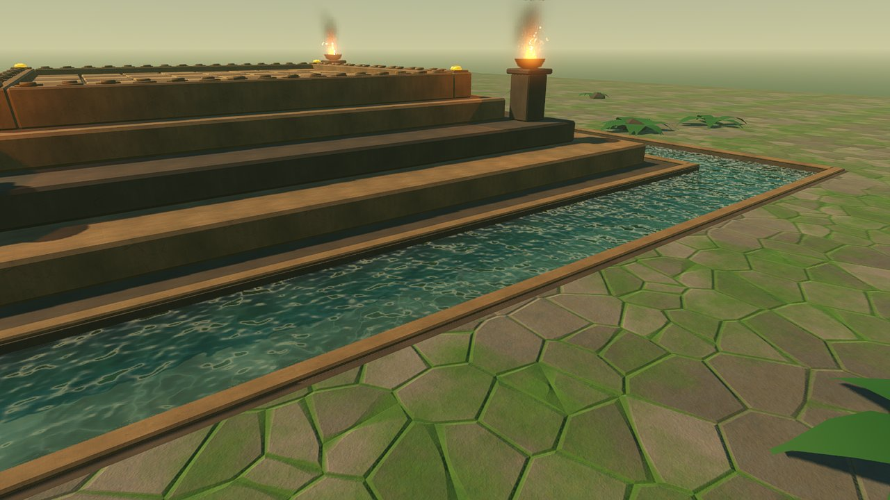

<!-- SPDX-License-Identifier: GPL-2.0-or-later -->
# Water

*Reference. The temple's water channel: where it is, the two water
shaders and their parameters, what each quality tier shows, and what it
costs. For technical artists tuning the water and graphics programmers
checking its cost. Why it is built this way: [Art direction, Water](../explanation/art-direction.md#water).
The look it must meet: [Visual target](visual-target.md#fire-water-and-particles).
Changing a theme's water: [Make a board theme](../how-to/make-a-board-theme.md);
how the tier picks the material: [Make content depend on the quality tier](../how-to/make-content-depend-on-the-quality-tier.md).
Owner: technical-artist (WP-50).*

| Look-dev frame | Scene | Renderer |
|---|---|---|
| [temple-water-desktop.jpg](../images/lookdev/temple-water-desktop.jpg) | `LD_Temple_Water` | Forward+ (`SH_Water`) |
| [temple-water-mobile.jpg](../images/lookdev/temple-water-mobile.jpg) | `LD_Temple_Water` | Mobile (`SH_WaterSimple`) |
| [temple-water-compatibility.jpg](../images/lookdev/temple-water-compatibility.jpg) | `LD_Temple_Water` | Compatibility, web (`SH_WaterSimple`) |
| [temple-board-water-desktop.jpg](../images/lookdev/temple-board-water-desktop.jpg) | `LD_Temple`, game camera | Forward+ |

Rendered in Godot 4.7.2 at 1280×720 on software Vulkan and OpenGL; regenerate them the way the board frames are made ([Board themes](board-themes.md#look-dev-reference-frames)).

## Where it is

A moat round the temple's lowest tier, cut into the jungle floor, with a
stone causeway under the far stair. All numbers come from the theme's
`water` block (below) and are computed in `water_channel()` in both
`tools/assets/gen_theme_meshes.py` and `tools/assets/gen_theme_scenes.py`.

| Temple value | Metres |
|---|---|
| Inner edge (half-width of the ring) | 8.45 (0.9 outside the lowest tier, which ends at 7.55) |
| Outer edge | 10.45 |
| Ground (rim) height, Godot Y | −1.92 |
| Water surface | −2.02 |
| Channel floor | −2.52 |
| Board rectangle | ±4.55, so the water is at least 3.9 m outside it |

Ferns and boulders keep 1.2 m clear of the outer edge, so the jungle
planting moved outward when the channel came in.

From the game camera at 16:9 the east and west strips show at the left
and right edges, about a tenth of the frame; taller screens also show the
near and far strips. Water never lies inside the board rectangle
(readability rule 2 in the visual target).

| File | What |
|---|---|
| `game/assets/models/<theme>/backdrop/SM_Backdrop_Water{East,West,Near,Far}.obj` | the surface, one 2 cm slab per strip (the far strip in two pieces either side of the causeway) |
| `SM_Backdrop_Ground.obj`, `SM_Backdrop_StoneDark.obj`, `SM_Backdrop_Stone.obj` | the ground with the channel cut out; channel floor, walls, apron and causeway; coping stones on both edges |
| `PF_Environment.tscn` | nodes `WaterEast` … `WaterFar` (`MI_Water`, no shadow casting) |
| `game/assets/materials/<theme>/MI_Water.tres`, `hi/MI_Water.tres` | base (`SH_WaterSimple`) and desktop (`SH_Water`) material |
| `game/assets/materials/shaders/SH_Water.gdshader`, `SH_WaterSimple.gdshader`, `SH_Water.gdshaderinc` | the shaders and their shared code |
| `game/assets/lookdev/LD_<Theme>_Water.tscn`, `LD_<Theme>_Water_Hi.tscn` | look-dev close-up of the east channel, base and desktop materials |

## Tiers

The tier picks the material through the `hi/` variant
([Quality tiers](quality-tiers.md#material-variants)); the feature id is
`water_refraction`.

| | `desktop-high` | `desktop-standard` | `mobile` | `web` |
|---|---|---|---|---|
| Material | `hi/MI_Water` (`SH_Water`) | `hi/MI_Water` at 0.77 render scale | `MI_Water` (`SH_WaterSimple`) | `MI_Water` |
| Ripple normals | 2 swells + 3 noise octaves | same | 2 swells + 2 octaves | same as mobile |
| Depth colour | absorption over the true path, from the depth texture | same | absorption over the path to the flat floor height | same as mobile |
| Refraction | screen texture, bent by the ripples, never toward what is in front of the water | same | — (blended over the real floor) | — |
| Caustics | 2 layers on the floor point from the depth texture | same | 1 layer on the flat floor point | same as mobile |
| Reflections | sky, through the engine's specular | same | sky | same as mobile |
| Contact line at the stone | yes | yes | — | — |

## Parameters

Theme key `materials.MI_Water`; `params` for the base, `hi.params` for the
desktop variant. The generator adds `floor_height` to materials marked
`"water": true`.

| Parameter | Shaders | Range | Temple | Meaning |
|---|---|---|---|---|
| `water_color` | both | colour | `#1d4a40` | colour deep water scatters back, lit by the scene |
| `absorption` | both | 0 to 4 per metre, per channel (negative counts as 0) | (1.1, 0.34, 0.28) | light lost per metre, red, green, blue; red goes first, so depth turns the water green-teal |
| `wave_scale` | both | 0.2 to 4 | 1.4 | ripple size; wavelength and height scale together, so the slope stays the same |
| `wave_strength` | both | 0 to 1 | 0.18 | ripple slope; capped at a 0.6 slope (about 31°) so no setting turns the surface into glitter |
| `flow_speed` | both | 0 to 0.5 | 0.05 | drift rate of the ripple noise (the pattern moves at about a third of this in m/s); the two swells and the caustics move at fixed slow rates |
| `roughness` | both | 0 to 0.3 | 0.04 | surface roughness of the reflections |
| `caustic_strength` | both | 0 to 4 | 2.2 | brightness of the caustic lines on the floor |
| `caustic_scale` | both | 0.2 to 4 | 1.3 | caustic pattern size |
| `refraction_strength` | `SH_Water` | 0 to 0.15 | 0.04 | screen-space bend per metre of water |
| `edge_softness` | `SH_Water` | 0 to 0.3 m | 0.08 | width of the soft line where the water meets stone |
| `floor_height` | `SH_WaterSimple` | metres, Godot Y | −2.52 (generated) | the flat channel floor the path length and caustics use |
| `floor_albedo` | `SH_WaterSimple` | 0 to 1 | 0.12 | how bright the caustic lines make the floor; they are added to the lit albedo, so they follow sun, shadow and exposure |

The theme's `water` block:

| Key | Temple | Meaning |
|---|---|---|
| `inset` | 0.9 | gap from the lowest tier to the inner edge, metres |
| `width` | 2.0 | channel width |
| `depth` | 0.6 | rim to floor |
| `level` | 0.1 | rim to water surface |
| `coping_width`, `coping_height` | 0.22, 0.06 | the stones along both edges |
| `causeway_width` | 3.0 | the stone crossing under the far stair |

A theme without a `water` block gets the old unbroken ground and no water
nodes.

## Shaders

| Shader | Render mode | Samplers | Cost per pixel |
|---|---|---|---|
| `SH_Water` | transparent pass (reads the screen texture), opaque result (no `ALPHA`), depth write, Burley diffuse, GGX | `hint_screen_texture` (linear, no mipmaps, clamp) and `hint_depth_texture` (nearest, clamp) | 2 depth and 1 screen sample; 3 noise octaves, and 2 caustic layers (4 noise evaluations) only where the caustics can show |
| `SH_WaterSimple` | blended (`ALPHA` from the absorption, at least the Fresnel), Burley diffuse, GGX | none | 2 noise octaves, 1 caustic layer (3 noise evaluations) where it can show, no texture samples, no trigonometry in the noise |
| `SH_Water.gdshaderinc` | — | none | gradient noise with analytic derivatives (integer hash, gradients from hashed bytes, no trigonometry), ripple slope, caustics, Beer-Lambert transmittance, Schlick Fresnel |

No static switches: two compiled user variants. Neither shader samples a
material texture, so the water adds no anisotropic or repeating sampler
and stays inside the 16 Metal sampler slots
([Board themes](board-themes.md#quality-tier-variants)). `SH_Water` is
written for Forward+ (Vulkan, D3D12, Metal) and checked on Vulkan; Metal is
checked by CI's macOS screenshot job when that job renders with Metal, and
D3D12 by no job yet (the Windows screenshot uses OpenGL through ANGLE).
`SH_WaterSimple` is checked on Mobile and Compatibility. Both use `TIME`, so Movie Maker captures are
repeatable at a fixed frame rate.

## Cost

| Measure | Value |
|---|---|
| Budget | `SH_WaterSimple` ≤ 0.3 ms at 1280×720 on an Intel UHD 620 class GPU; `SH_Water` ≤ 0.5 ms at 1440p on the benchmark Mac (M4) |
| Measured | desktop-high, 2560×1440, Apple M4 ([benchmark](benchmark.md), busiest board, main and the branch run alternately in one session): the version with an in-shader screen-space reflection march (up to 16 steps and 3 refinements, 21 depth and 2 screen samples per pixel) added 3.9 ms per frame at p50 and p95 (20.8 → 24.7 ms p50), all of it on the GPU; the march was removed for that reason. The shader as it stands is pending a re-measure |
| Estimate | software rendering (lavapipe, llvmpipe) cannot resolve the cost: the water close-up runs at the same 6.5 fps at 640×360 with the water shader, with the march, with `SH_WaterSimple` or with no water. By count: `SH_WaterSimple` is up to 5 noise evaluations (2 for the ripples, 3 for the caustics), each 4 integer hashes and no trigonometry, and no texture samples; `SH_Water` up to 7 noise evaluations and 3 texture samples |
| Triangles | 12 per strip slab (60 in all); the channel adds about 400 to the backdrop |
| Reflection probes | none. The first version had a box probe per strip: they took video memory from 578 to 1095 MB on the M4 (Godot's default 64-slot reflection atlas) and, on lavapipe at 640×360, the bench's p50 from 263 to 687 ms with the water (306 ms without it), so they were removed |
